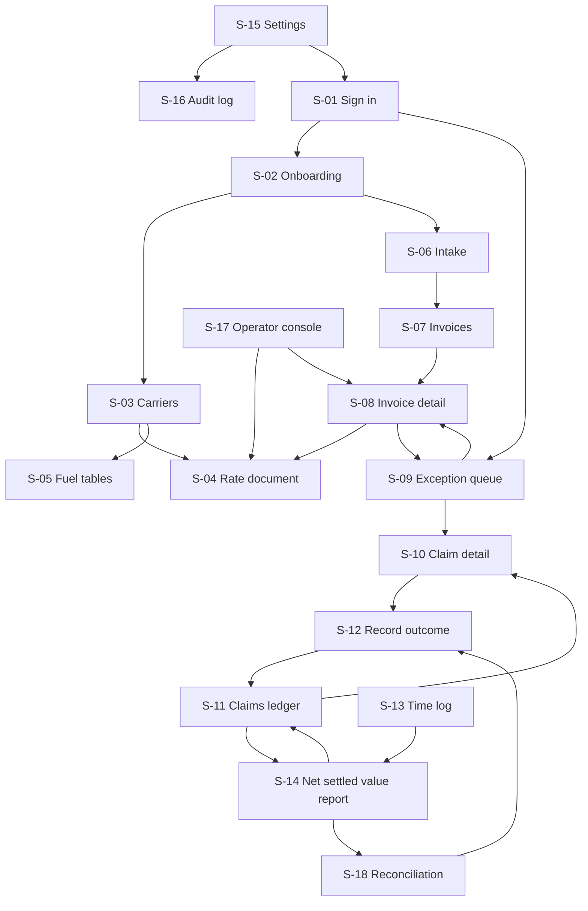

# App flow — FreightCheck carrier invoice audit

Roles: [PRD.md](PRD.md#6-buyer-users-and-roles). Look and wording: [design.md](design.md). "Auditor+" = Auditor, Approver, Owner. Operator rights apply only inside a live grant and never include approve, send-record or settlement.

## 1. Navigation

The left navigation reaches S-06, S-07, S-09, S-11, S-13, S-14, S-03 and S-15 from every screen; sign-out is in the account menu on every screen.

## 2. Screen inventory

| ID, route | User story (MH) | Roles | Entry conditions | Inputs | Visible data | Actions and destinations | Acceptance check |
|---|---|---|---|---|---|---|---|
| S-01 `/sign-in`, `/sign-in/code`, `/sign-in/enrol`, `/reset`, `/invite/:token` | Sign in safely (MH-13) | Any | None; enrol and invite need a valid single-use link | Email, password, 6-digit code or recovery code; at enrolment the authenticator setup and ten recovery codes to save | Errors without revealing which field was wrong | Sign in → last unfinished item or S-09; invitation → set password → enrol → S-02 or S-09; sign-out returns here | Wrong code 5 times locks for 15 minutes; a used code or recovery code is refused; a reset link works once and still asks for the code |
| S-02 `/onboarding` | Know what is still missing (MH-03, MH-11) | Owner, Approver | Tenant created after signed order form | Hourly rate, tolerance, claim threshold, allowed sender domains | Checklist: carriers added, rate documents confirmed, forwarding address tested, time rate set | Each item → S-03, S-06, S-15; grant operator access | Each item shows done only from stored data; leaving and returning keeps progress |
| S-03 `/carriers`, `/carriers/:id` | Keep carriers and their documents (MH-03, MH-09) | Read: all; edit: Approver+ | Signed in | Carrier name, SCAC, type (motor carrier, broker), claims email, dispute window days with source file | Documents per carrier by type, effective dates, date basis, revision, status (entered, confirmed, superseded); gaps in coverage | Add document → S-04; fuel → S-05 | A contract dispute window cannot be saved without a source file; broker with none shows "no default applied" |
| S-04 `/rate-documents/:id` | Confirm rules against the source (MH-03) | Enter: Auditor, Operator; confirm: Approver | Document uploaded | Rule rows: lane or zone, class or FAK, rate basis, minimum, discount, accessorial amounts, effective dates | Source page beside the rows; who entered; overlaps | Save draft; Confirm (Approver) → S-03; Supersede | Unconfirmed rules are never used by a check; overlapping confirmed dates are refused with the conflicting version named |
| S-05 `/fuel` | Fuel by the right week (MH-06) | Read: all; enter: Auditor+; confirm schedule and index values: Approver | Carrier exists | Schedule bands (index from, to, percent or per mile), date basis, effective-week rule; weekly index value, its publication date and where it was read | Missing weeks; unconfirmed values; schedule and value revisions | Add week; confirm value; correct value (new revision); confirm schedule → S-03 | A shipment whose week is missing or unconfirmed gives a fuel exception, not a guess; correcting a confirmed value lists the claims it marks stale or changed after send |
| S-06 `/intake` | See what arrived (MH-01) | Auditor+ | Signed in | Files (drag or picker); AP CSV of payments, credits and refunds with received dates; batch origin (lookback, pilot, recurring) | Forwarding address; each message or batch with per-file state: received, scanning, extracting, needs review, done, duplicate, failed, quarantined | Retry failed; open → S-08 | A batch of 20 with 2 bad files shows 18 done and 2 failed with reasons; retry does not duplicate the 18 |
| S-07 `/invoices` | Find an invoice (MH-04) | All | Signed in | Filters: carrier, date, status, check result | Rows: carrier, invoice number, PRO, total, status (needs review, needs input, clean, variance), days left | Open → S-08; select rows → re-run checks | "Clean" never appears on a row with any exception |
| S-08 `/invoices/:id` | Confirm fields and see each check (MH-02, MH-04, MH-05, MH-06) | Read: all; edit: Auditor+, Operator | Invoice exists in tenant | Field corrections; receipt date with a note of the evidence; document links (BOL, rate confirmation, delivery receipt, weight certificate) | Page image with highlighted region; fields with confidence; check list with status, document revision, governing date, arithmetic; duplicate candidate side by side; contest-by date, its basis and the receipt evidence | Confirm fields; re-run; open rule → S-04; send variance to queue → S-09 | Each check shows its own status even when another is exception; a correction creates a new field revision and re-runs checks; an invoice forwarded 60 days after its invoice date with no receipt evidence shows the invoice-date proxy, never the forward date |
| S-09 `/exceptions` | Work the queue (MH-07) | Auditor+ | Signed in | Decision: confirm for claim or dismiss with reason | Variances above tolerance by reason code, amount, days left; separate tab "below claim threshold"; separate tab "needs input" for exceptions | Confirm → draft created → S-10; dismiss; open → S-08 | Dismiss requires a reason; exceptions are never listed as cleared |
| S-10 `/claims/:id` | Approve and record sending (MH-08) | Read: all; prepare: Auditor+; approve, send-record: Approver | Claim exists | Recipient, send date, optional note | Draft text; lines with expected, billed, document and page; attachments; rule versions and governing date; contest-by date; status timeline | Approve; download packet (.eml and PDF); copy text; Mark as sent; Withdraw; → S-12 | Approve on a stale basis returns the old and new amounts and does not approve; approve after the contest-by date is refused unless a reason is typed; Mark as sent is refused while stale and needs date and recipient or an authenticated BCC copy; a sent claim whose basis changed shows the banner and the withdrawal note |
| S-11 `/claims` | Follow every claim (MH-10) | All | Signed in | Filters: carrier, status, age | Per claim: claimed, accepted, settled, pending; sent date; 30-day and 60-day expected dates; contest-by date | Open → S-10; export CSV; → S-14 | Column totals equal the sums in S-14 for the same filter |
| S-12 `/claims/:id/outcome` | Record decision and settlement (MH-10) | Approver | Claim is sent | Event type (acknowledged, accepted, partly accepted, denied, rebilled, withdrawn); reason code for denial, part acceptance and withdrawal; accepted amount; settlement method, amount, date; document upload | Claimed amount; prior events | Save → S-10; reverse a settlement | Settlement cannot be saved without a document; short-pay without acceptance is stored as an event, not a settlement |
| S-13 `/time` | Log time (MH-11) | Auditor+ | Signed in | Activity (setup, review, dispute), minutes, date; timer start and stop | Entries by user and week; total cost at the tenant rate | Add, edit with reason | An edit keeps the previous value in history |
| S-14 `/reports/nsv` | See whether it pays (MH-12, MH-15) | Viewer+ | Signed in | Window; plan (flat or gainshare) | Invoices audited, claimed, accepted, settled, pending, fee, time cost, NSV, each split by origin (lookback, later); baseline; fee statement lines; count of unmatched carrier credits | Drill to rows → S-11, S-13, S-18; download PDF and CSV | Settled excludes accepted-unsettled and pending; every figure drills to rows that sum to it; lookback and later claims never share a subtotal |
| S-15 `/settings` | Control users and data (MH-13, MH-14) | Owner | Signed in | Invite user and role; change role; remove user; reset a user's lost second factor; hourly rate; tolerance; claim threshold; sender domains; operator grant with expiry; export; deletion request | Users, last sign-in, grants | Export → download when ready; delete → confirmation; → S-16 | Deletion asks for the tenant name typed in full; role change takes effect on the next request |
| S-16 `/audit` | See who did what (MH-13) | Owner | Signed in | Filters | Actor, role, action, entity, time, grant ID | Open entity | Operator actions show the grant |
| S-18 `/reconciliation` | Make sure every carrier credit is counted once (MH-15) | Approver, Owner; read: Viewer, and FreightCheck staff for gainshare tenants | AP export imported | Match to a claim, or mark unrelated with a reason | Carrier credits and refunds from the AP export with no settlement; candidate claims by carrier, PRO and amount | Match → creates or links a settlement (document still required) → S-12; mark unrelated; → S-14 | A fee statement cannot be issued while a credit in its period is unmatched |
| S-17 `/operator` | Set up rates for a customer (MH-03) | Operator | Live grant | Tenant choice among granted | Setup queue per tenant | → S-04, S-08 inside the granted tenant | With no live grant the tenant is not listed and its URLs return 404 |

## 3. States

| State | Where | Behaviour |
|---|---|---|
| Empty | S-06, S-07, S-09, S-11, S-14 | Says what is missing and links to the next step: "No invoices yet. Forward one to the address above or upload." |
| Loading | All lists | Skeleton rows; no layout jump |
| Processing | S-06, S-08 | Per-file state with elapsed time; page polls; announced politely to assistive technology |
| Partial success | S-06 batch; S-07 bulk re-run | Summary counts plus a list of failures with reasons; retry acts only on failures |
| Validation error | All forms | Message beside the field and in a summary at the top that receives focus; entered values kept |
| Permission denied | Any route | In-tenant but wrong role: page stating the role needed. Foreign or unknown ID: not found |
| Timeout | Upload, approve, export | "Still working. Nothing was lost." with Retry; retry reuses the idempotency key |
| Session expired | Any | Sign in again → return to the same route; unsaved form values restored from local draft |
| Stale basis | S-10 | Banner with old and new amounts; approve and Mark as sent disabled until reviewed and re-approved |
| Basis changed after send | S-10, S-11 | Banner and ledger flag with old and new amounts; actions: Withdraw (note generated) or record "reviewed, claim stands" with a reason |
| Past contest-by | S-09, S-10 | Row and claim marked "past contest-by date"; approve asks for an override reason; unsent claims become expired at the daily sweep |

## 4. Browser behaviour

| Topic | Rule |
|---|---|
| Refresh | Every screen rebuilds from the URL and server state; filters and window live in the query string (R-18) |
| Back and Forward | Never re-submit; forms use POST then redirect |
| Deep links | Any `/invoices/:id` or `/claims/:id` opens after sign-in if the user's tenant and role allow |
| Duplicate submission | Buttons disable on click; server enforces `Idempotency-Key`; a second approve returns the first result |
| Batch actions | Bulk re-run and bulk confirm for claim; each row gets its own result; no bulk approve of disputes |
| Unfinished work | Field corrections and outcome forms save drafts per user; S-01 returns to the last unfinished item |
| Two users, one claim | Second writer gets "changed by another user" with the new state; nothing is overwritten |

## 5. Irreversible and external actions

| Action | What the user reviews first |
|---|---|
| Approve dispute | Carrier, invoice, each line's expected and billed amount, governing document, revision, page, effective dates, date basis and governing date, contest-by date with its basis and days left, attachments |
| Mark as sent | Recipient and date; warning that the carrier now holds the claim |
| Record settlement | Amount, method, document preview; effect on NSV and, on gainshare, on the fee |
| Withdraw claim | Reason; the withdrawal note that the user must send |
| Delete tenant data | What is removed, backup expiry date, that it cannot be undone |

## 6. Primary path, by role

1. Owner signs in (S-01), completes onboarding (S-02), grants operator access (S-15).
2. Operator enters rules (S-17, S-04); Approver confirms them (S-04, S-05).
3. Auditor forwards invoices, watches intake (S-06), confirms fields (S-08).
4. Auditor works the queue (S-09); Approver approves and marks sent (S-10).
5. Approver records the carrier decision and settlement (S-12); everyone follows the ledger (S-11).
6. Owner reads the report (S-14) and signs out (account menu → S-01).
