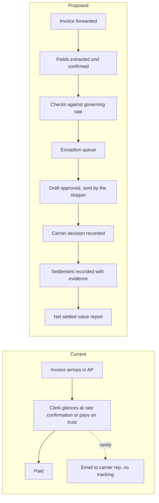

# PRD — FreightCheck carrier invoice audit

Labels and sources: [Decision.md](Decision.md#0-how-numbers-are-labelled). Risks are cited by ID from [verification-report-fixing.md](verification-report-fixing.md#5-production-risk-register).

## 1. Overview

FreightCheck takes a shipper's LTL and truckload carrier invoices, checks each line against the document that governed the shipment, and follows every resulting claim until the carrier settles it or refuses. The pilot must show whether settled credits exceed the shipper's setup, review and dispute costs.

## 2. What the product does

1. Receives invoices and supporting documents by forwarding inbox or upload.
2. Extracts invoice fields with a model; a person confirms uncertain fields against the page image.
3. Resolves the governing rate for the shipment date: contract rate sheet, tariff, accessorial schedule, fuel surcharge table, or rate confirmation.
4. Runs deterministic checks; each returns pass, variance, exception or not applicable.
5. Drafts a dispute from a template with the evidence attached. A person approves it and sends it from their own mailbox.
6. Records the carrier's decision and the settlement, each with a document.
7. Reports claimed, accepted and settled amounts, the fee, the shipper's logged time, and the net.

## 3. Why now

Triggers named in the brief `[C]`: a new controller, a general rate increase, a reclass dispute, freight over budget, NMFC classification changes. The statutory window is short: 180 days from receipt of the bill `[S: SRC-01]`. No market timing claim is made beyond these.

## 4. Goals

| ID | Goal |
|---|---|
| G-1 | Answer the decisive question for each pilot account with carrier-evidenced numbers |
| G-2 | Never send, or help send, a dispute computed on the wrong rate basis |
| G-3 | Keep the shipper's time per claim low enough that small claims are worth sending |
| G-4 | Keep one tenant's rate agreements invisible to every other tenant |

## 5. Problem statement

Small and mid-size shippers pay carrier invoices without checking them against the quoted rate, the bill of lading and the accessorial rules `[C]`. Checking by eye is slow, and a dispute needs the governing document, the bill and follow-up over weeks. The size of the loss is known only from vendor ranges ([Decision.md](Decision.md#2-why-the-buyer-might-pay-and-why-not)).

## 6. Buyer, users and roles

Buyer: logistics manager or controller; budget with the CFO or VP operations `[C]`.

| Role | Person | Can | Cannot |
|---|---|---|---|
| Owner | Controller | Everything in the tenant: users, plan, export, deletion, time rate | See other tenants |
| Approver | Logistics manager | Confirm rate rules, approve disputes, record decisions and settlements | Manage users or billing |
| Auditor | AP clerk, coordinator | Upload, correct extractions, review findings, prepare claims, log time | Approve a dispute, confirm a rate rule, record a settlement |
| Viewer | CFO | Read reports and ledger | Change anything |
| Operator | FreightCheck staff | Enter rate documents and fix extractions inside a tenant under a time-limited grant from the Owner | Approve disputes, record settlements, act without a grant |

## 7. Current and proposed workflow

## 8. Must-haves

Priority P0 = pilot cannot run without it; P1 = needed within the pilot.

| ID | P | User story | Observable acceptance criteria | Owner role |
|---|---|---|---|---|
| MH-01 | P0 | As an Auditor I forward or upload invoices and supporting documents so nothing is keyed. | A PDF sent to the tenant inbox or uploaded appears in intake within 2 minutes with its sender and received time. The same file sent twice creates one record. An unsupported or oversized file is refused with a reason. | Auditor |
| MH-02 | P0 | As an Auditor I confirm extracted fields against the page. | Each field shows value, confidence and its page region. Fields under the confidence floor and all money fields that fail the line-sum test are marked unconfirmed until a person confirms or corrects them. Every correction keeps the old value, user and time. | Auditor |
| MH-03 | P0 | As an Approver I keep each carrier's governing documents with effective dates. | A rate document has a type, carrier, effective-from and optional effective-to, its file, and a governing-date basis (pickup, tender, delivery or invoice date) with the page that states it; if the document is silent the Approver chooses and the choice is flagged. All rules of a document are inactive until an Approver confirms the document against the source. Changing a confirmed document creates a new revision that must be confirmed again. Two confirmed documents of one type cannot overlap in dates for one carrier and lane scope. | Approver |
| MH-04 | P0 | As an Auditor I get a result per check per invoice. | Each applicable check returns pass, variance, exception or not applicable, with the rule version used and the arithmetic. A missing governing rate or unconfirmed field yields exception. An exception is never shown or counted as pass and never prevents the other checks from running. An invoice is "clean" only when every applicable check passed. | Auditor |
| MH-05 | P0 | As an Auditor I see duplicate billing. | Same carrier and invoice number, or same carrier and PRO with a different invoice number, or same PRO, date and total, is flagged with both records side by side, across the whole history including the AP payment import. | Auditor |
| MH-06 | P0 | As an Auditor I see fuel surcharge checked for the right week. | The check uses the carrier's schedule revision effective on the governing date, the date basis and effective-week rule the schedule states, and the index value that rule selects. The result shows index value, its week, band, expected and billed. Index values are entered by an Auditor and confirmed by an Approver; a missing or unconfirmed value, basis or week rule makes the fuel line an exception while every other check still runs. Correcting a confirmed value creates a new revision and marks dependent claims as in MH-08. | Auditor |
| MH-07 | P0 | As an Auditor I work one queue of variances. | Queue lists variances above the tenant tolerance, by reason code, amount and days left. Each can be confirmed for claim or dismissed with a reason. Variances under the claim threshold are listed separately and not drafted. | Auditor |
| MH-08 | P0 | As an Approver I approve a dispute before it leaves. | The draft shows carrier, invoice, each claimed line with expected and billed, the governing document and page, and attachments. Approval recomputes every line and is refused if any basis changed since drafting (stale) or if the contest-by date has passed, unless the Approver overrides the date with a typed reason. Approval freezes the claimed amount. A stale approved claim cannot be marked sent, and recording the send recomputes the basis again. Recording a send after the contest-by date needs a typed override with the Approver recorded, unless the approval carried one (review round 1, 2026-11-11). A claim already sent whose basis later changes is flagged "basis changed after send" with a generated withdrawal note. FreightCheck never emails a carrier. The user sends from their own mailbox and the claim becomes "sent" only with a send date and recipient, or a BCC copy that passed sender authentication from a tenant user's address. | Approver |
| MH-09 | P0 | As an Approver I see how long I have. | Receipt means the shipper's receipt of the carrier's bill. The receipt date comes only from the carrier's original transmission (an attached original message or a redirect that keeps the carrier's headers), the shipper's AP received stamp, or a user entry with a note; the earliest available is used; an evidence date after today or after the forward reached FreightCheck is refused (review round 1, 2026-11-11). The time FreightCheck received a forward is never used. With no evidence the invoice date is used as the earliest defensible date and labelled as a proxy. Each invoice shows a contest-by date, its basis (receipt + 180 days, invoice-date proxy + 180 days, or contract term with its source) and days left. A missing governing or invoice date is an exception, not a guess. A broker invoice with no contract term shows "no default applied" and is never given an invented date. Reminders go to Approvers at 30, 14 and 3 days; an unsent claim past its date is marked past contest-by, never expired automatically: approving or sending it then needs the MH-08 override with a typed reason and the Approver recorded (review round 2, 2026-11-11). | Approver |
| MH-10 | P0 | As an Approver I record what the carrier decided and what was settled. | Claimed, accepted and settled are separate amounts. Accepted cannot exceed claimed; settlements cannot exceed accepted (or claimed before a decision) without a recorded reason; a claim is "settled" only after a carrier decision accepting money and settlements covering it (review round 1, 2026-11-11). Accepted needs a decision document. Settled is the sum of settlements, each with method (credit memo, refund, corrected invoice, accepted short-pay), date and document. A short-pay with no carrier acceptance is not a settlement. Every claim carries its origin (lookback, pilot or recurring). A denial or withdrawal carries a reason code, one of which is "wrong rate basis". | Approver |
| MH-11 | P1 | As an Auditor I log time spent so the net is honest. | Setup, review and dispute minutes are captured per user and day, by timer or manual entry, and can be corrected with history. The Owner sets the hourly rate; if none is set the report says so and uses the stated default. | Auditor |
| MH-12 | P0 | As an Owner I see whether this pays. | Report for a window shows invoices audited, claimed, accepted, settled, pending, fee, time cost and net settled value, each number linking to its rows, with lookback claims and later claims shown separately and in total. Pending and accepted amounts are never added into settled. | Owner |
| MH-13 | P0 | As an Owner I control who sees our rates. | Every read and write is limited to the user's tenant and role. Sign-in needs password and a time-based code. Cross-tenant requests return not found. Every approval, send record, decision, settlement, export and grant is in the audit log. | Owner |
| MH-14 | P1 | As an Owner I can take our data out and have it deleted. | Export produces invoices, findings, claims, events and settlements as CSV plus files. Deletion removes files and rows within the stated period and reports completion. | Owner |
| MH-15 | P1 | As an Owner on gainshare I see exactly what the fee is based on. | The fee statement lists each settlement, its document and 20% of its amount. A settlement that is reversed produces a negative line in the next statement. Before a statement is issued, carrier credits and refunds in the month's AP export that match no settlement are listed; each must be matched to a claim or marked unrelated with a reason by an Approver, and FreightCheck staff can see the list. | Owner |

### 8.1 Check catalogue

Deterministic; each runs independently of the others (MH-04).

| Code | Check | Needs |
|---|---|---|
| C-01 | Duplicate billing. A possible duplicate is a question shown side by side and carries no claimable amount until the AP payment import shows a double payment; a carrier's corrected invoice (`revision_of`) supersedes its original and is never its duplicate (review round 1, 2026-11-11) | Invoice history, AP payment import |
| C-02 | Linehaul, discount and minimum charge against the governing rate. Where the contract is a discount off a base tariff the shipper does not hold `[S: SRC-11]`, the base rate is an exception (`BASE_TARIFF_UNAVAILABLE`) and only the discount percentage and minimum are checked against the gross charge printed on the invoice. Reported as `C-02` (net linehaul) and, for the base-rate exception, `C-02-BASE` | Contract rate sheet, tariff or rate confirmation; base tariff rates where the contract refers to one |
| C-03 | Fuel surcharge for the governing date, on the expected linehaul. When the linehaul check has no expected amount, the fuel line is an exception (`FSC_BASIS_MISSING`), never a variance on the billed linehaul. When a carrier-specific and a tenant-wide confirmed value exist for one week, they must agree (the carrier's is then used) or the line is an exception (review round 1, 2026-11-11) | Fuel schedule, weekly index value |
| C-04 | Accessorial amount against the schedule, and whether the service was requested or documented. Reported per line as `C-04` (amount) and `C-04-SUPPORT` (support question; `DOCUMENT_MISSING` when no bill of lading is linked) | Accessorial schedule, bill of lading, delivery receipt |
| C-05 | Reweigh: billed weight differs from the bill of lading | Bill of lading, carrier weight certificate |
| C-06 | Reclass: billed class differs from the bill of lading | Bill of lading, carrier inspection certificate |
| C-07 | Arithmetic: lines sum to the total | Invoice only |
| C-08 | Additional charges billed more than 180 days after receipt of the original bill `[S: SRC-01]`; flagged for human review, never asserted | Both bills' dates |

C-04's support test, C-05, C-06 and C-08 raise a question for a person; they never state that the carrier is wrong.

## 9. Non-goals

| Not in the MVP | Why |
|---|---|
| Sending disputes to carriers or negotiating | The shipper owns the relationship; the brief asks for a draft `[C]` |
| Paying carriers or holding funds | Audit, not payment |
| Parcel, ocean, air, rail | Different documents; launch niche is LTL and truckload `[C]` |
| TMS, quoting, rating engine for new shipments | Free TMS products exist `[S: SRC-10]` |
| Reproducing NMFC text or deciding freight class | Licensed content `[S: SRC-23]`; class disputes need judgment |
| Model-written dispute text or model pass/fail decisions | Amounts and citations must be exact |
| QuickBooks, NetSuite, EDI integrations | Listed as scale items `[C]`; pilot uses forwarding and one CSV import |
| Legal advice on limitation periods | Dates are shown with their source only |

## 10. Success metrics

**Net settled value (NSV) = S − F − T**, per account and window.

- S: sum of settlement amounts whose carrier document is dated inside the window, for claims on in-scope invoices. Source: settlement records (MH-10).
- F: FreightCheck fees invoiced for the window. Source: fee statements.
- T: logged minutes ÷ 60 × the Owner's hourly rate, for setup, review and dispute. Source: time entries (MH-11). Default rate USD 40 `[A]`, labelled when used.
- **Hand-run adjustment.** While the founder delivers a pilot by hand, the founder's minutes on field confirmation and queue review for that account (work the product gives to the shipper) are logged and added to T at the shipper's rate. The result is **self-serve NSV**; clause C and the commercial target use it. Total founder hours per pilot are reported beside it. Without the adjustment the figure describes a done-for-you service, not this product.
- Scope: S is reported for pilot-period claims (the recurring indicator, used for clause C and the refund test) and separately for lookback claims (one-time).
- Baseline: carrier credits the same shipper obtained in the 90 days before the lookback, from its AP records, scaled to the window length. Reported beside S, not subtracted, because most prospects are expected to have none `[A]`.
- Window: invoices received in pilot days 1-60; readings at day 60 and day 120.

| Kind | Metric | Method and denominator | Window | Baseline | Proposed target `[P]` |
|---|---|---|---|---|---|
| Commercial | Self-serve NSV per pilot account, pilot-period claims | As above | Day 120 | Prior credits, usually 0 `[A]` | Above 0 |
| Commercial | Settled ÷ claimed | Sum settled ÷ sum claimed, claims sent in the window | Day 120 | 60% assumed `[C]` | Reported; no target until measured |
| Commercial | Pilot to recurring | Accounts with an order form ÷ pilots ended | Day 61 | None | 75% `[A]`, the rate the ramp in Decision 7.5 needs; with the first two pilots that means both, and one of two (50%) is the downside in which break-even never arrives |
| Commercial | Base rate resolvable | Invoices whose C-02 ran in full ÷ LTL invoices audited | Per lookback | None | Reported; under 50% triggers the re-scope in Decision 10 |
| Commercial | Identified error, audit month | Sum of confirmed variances in the audit month | Per lookback | None | Above USD 500 in 2 of 5 `[C]` |
| Workflow quality | Field accuracy | Confirmed-unchanged fields ÷ fields extracted, pilot invoices | Per month | None | Above 95% `[C]` |
| Workflow quality | Shipper minutes per claim sent | Dispute and review minutes ÷ claims sent | Per month | 25 assumed (5 + 20) `[A]` | At or under 25 |
| Workflow quality | Median hours, intake to finding | Timestamps on file and check result | Per month | None | Under 24 |
| Failure | Wrong-basis disputes sent | Claims withdrawn or denied with reason code `wrong_rate_basis`, plus claims flagged basis changed after send ÷ claims sent | Pilot | None | 0 |
| Failure | Dismissed variances | Variances dismissed as not an error ÷ variances raised | Per month | None | Under 20% |
| Failure | Claims past contest-by date unsent | Count ÷ claims confirmed | Pilot | None | 0 |
| Failure | Approvals by date override | Count ÷ claims approved | Pilot | None | Reported |
| Failure | Settlements reversed | Reversed ÷ recorded | Pilot | None | Reported |

## 11. Highest-cost user mistakes

Ranked by consequence to the buyer.

1. **Wrong-basis dispute sent.** A dispute goes to a carrier claiming an amount computed from a rate document version or fuel surcharge week that did not govern the shipment. It is external, in the shipper's name, cannot be recalled, wastes the carrier's goodwill and can discredit every later claim. Prevention: only Approver-confirmed rule versions are used; the draft shows document, page, effective dates and governing date; a rule changed after drafting voids the draft (MH-03, MH-08). Review: the Approver, at approval. Correction: record a withdrawal on the claim, send the generated withdrawal note, fix the rule version, re-run checks; the withdrawn claim stays in the ledger and in the failure metric.
2. **Unsettled credit counted as settled.** A promised or short-paid amount is entered as settled, overstating NSV and the gainshare fee. Prevention: settlement requires a carrier document and a method; short-pay needs acceptance (MH-10). Review: Owner at fee statement. Correction: reverse the settlement; a negative line follows (MH-15).
3. **Deadline missed or miscounted.** A confirmed claim sits past its contest-by date, or the date was counted from the day the invoice was forwarded instead of the day the shipper received it, so a time-barred dispute is sent. Prevention: receipt evidence rules, the labelled proxy, reminders, and refusal of approval past the date (MH-09, MH-08). Review: Approver weekly. Correction: none in the product; the claim is marked expired, or sent under a recorded override.

## 12. Dependencies

| Dependency | Needed for | If absent |
|---|---|---|
| Shipper supplies rate documents | MH-03, MH-04 | Checks return exception; duplicates and arithmetic still run |
| Shipper holds the base tariff its discounts apply to | C-02 in full | Base rate is an exception; discount and minimum still checked |
| Shipper supplies a monthly AP export of carrier credits (gainshare) | MH-15 | Fee on carrier-accepted amounts |
| Shipper supplies bills of lading and delivery receipts | Accessorial, reweigh and reclass checks | Those checks return exception |
| Shipper records carrier responses | MH-10, MH-12 | Ledger shows pending; NSV understates |
| Inbound email provider | MH-01 | Upload still works |
| Extraction model provider | MH-02 | Manual keying form |
| Carrier's fuel index values | MH-06 | Exception until the weekly value is entered |
| Signed NDA and data authorization | Any intake | No data accepted |

## 13. Constraints

- Sell before building; a paid pilot is mandatory `[C]`.
- One founder for selling and delivery; team of 1-3 developers `[C]`.
- USD only; US carriers; English.
- Customer rate data is confidential `[C]`; no real customer document enters the repository.
- Dates, money, access and deadline logic are deterministic code.

## 14. Evidence that would justify expanding the MVP

| Evidence | Expansion |
|---|---|
| Two pilots with NSV above 0 and minutes per claim at or under 25 | Accounting export, then QuickBooks bills |
| Buyers ask FreightCheck to send and chase disputes | Managed dispute service, priced on settlement |
| Half of intake arrives from one TMS | Integration with that TMS |
| Rate setup exceeds 4 hours per carrier | Assisted rate-sheet extraction with human confirmation |
| Canadian shippers ask | Canadian carriers and CAD; re-check outreach consent first |
