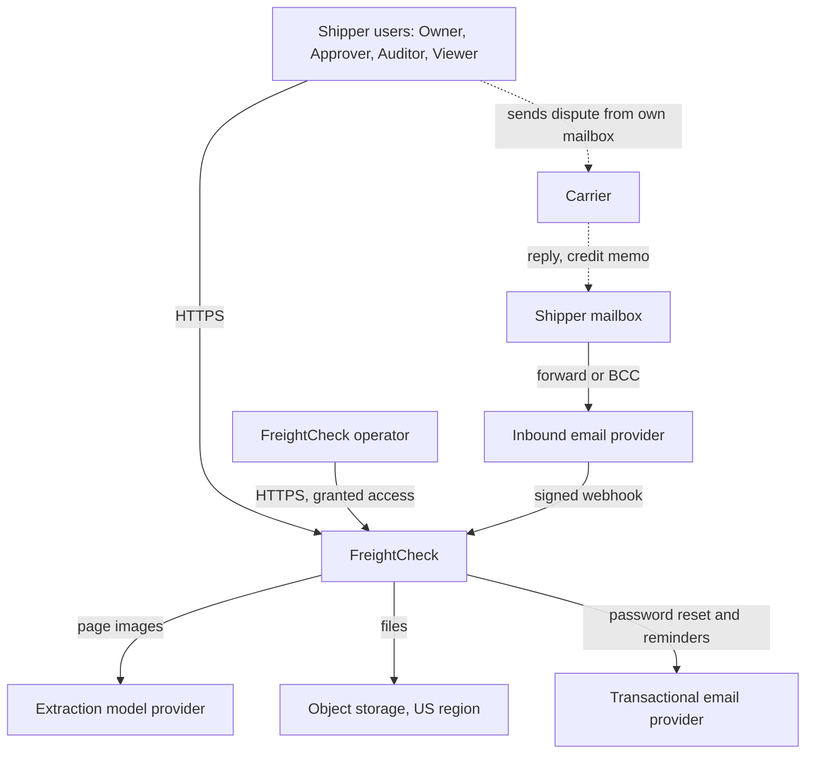
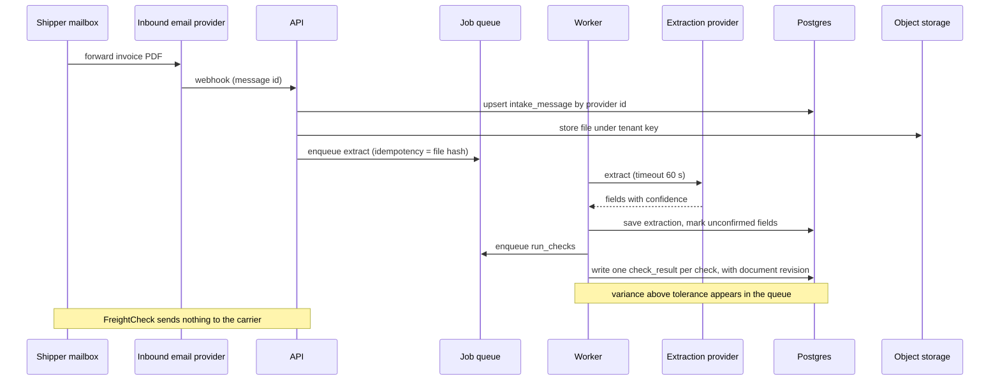
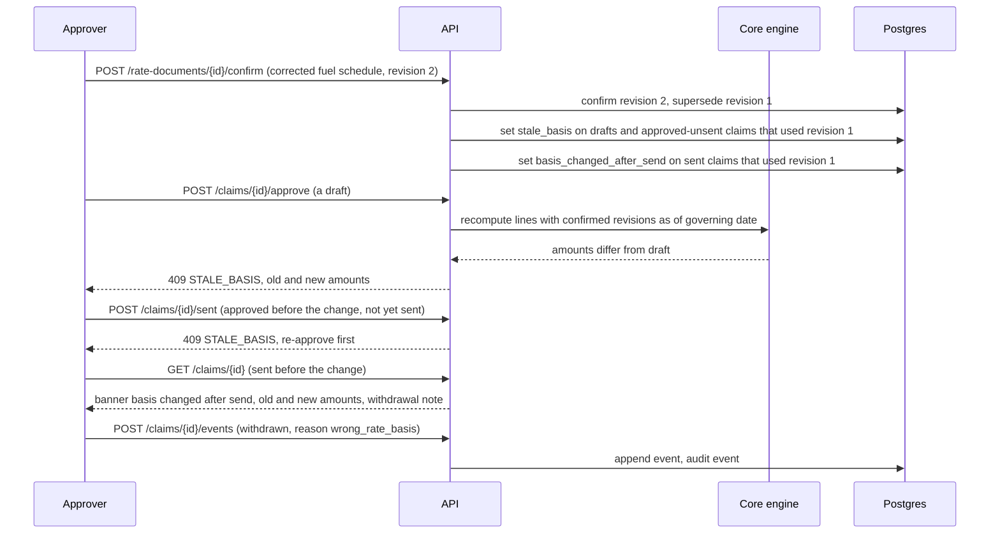
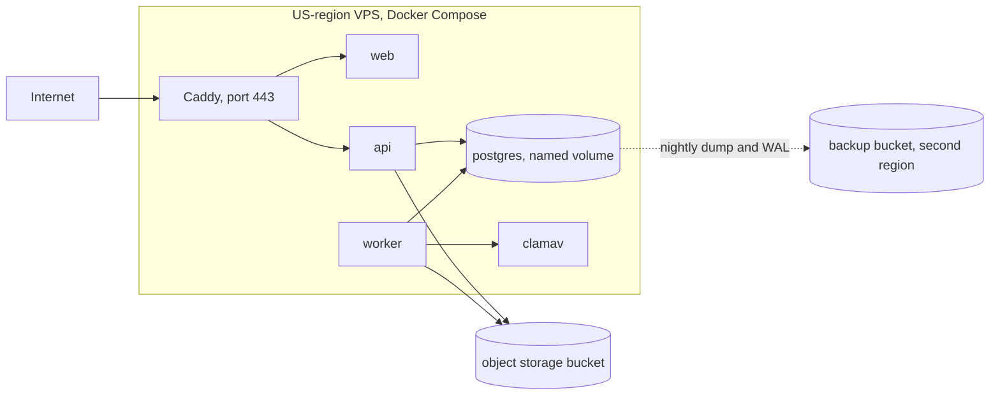

# TRD — FreightCheck carrier invoice audit

arc42 order. Every choice is a proposal `[P]` until built; every command is **proposed**, none exists. Labels: [Decision.md](Decision.md#0-how-numbers-are-labelled). Risks by ID: [verification-report-fixing.md](verification-report-fixing.md#5-production-risk-register).

## 1. Introduction and goals

Requirements: [PRD.md](PRD.md#8-must-haves). Quality goals in order: (1) correctness of the rate basis and of money states, (2) tenant isolation of rate agreements, (3) recoverability of claim history, (4) low reviewer effort.

## 2. Constraints

| Constraint | Source |
|---|---|
| 1-3 developers, one founder operating | `[C]` |
| Founder owns hosting, a domain and a VPS; its region is not stated | `[C]` |
| USD 550 monthly fixed cost and USD 44.39 variable per account in the model | `[C: model]` |
| US customer data stays in a US region; founder access from Canada is disclosed | `[P]` |
| No real customer document in the repository | SPEC |

## 3. Context and scope

FreightCheck has no connection to carriers. Carrier replies reach it only when a shipper forwards them.

| External system | Direction | Contract |
|---|---|---|
| Inbound email provider (Postmark suggested `[C]`) | In | JSON webhook with attachments; signature verified; provider message ID is the idempotency key |
| Extraction provider | Out | One call per page set; pinned model version. The page images themselves show the shipper's name, its carriers and its rates, so the provider sees confidential data; no-training and deletion terms are required in writing before any customer file is sent. No tenant ID or other metadata is added |
| Object storage | Both | S3 API; private bucket; short-lived signed URLs |
| Transactional email | Out | Password reset, deadline reminders to users only |

## 4. Solution strategy

| ID | Decision | Reason | Tradeoff |
|---|---|---|---|
| AD-01 | Deterministic check engine in a pure Python package with no I/O | Dates, money and deadlines must be reproducible and testable without a database | Rule entry is manual work |
| AD-02 | Model used only for field extraction | Scanned layouts vary `[C]`; everything downstream is arithmetic | Needs review UI and fixtures |
| AD-03 | Dispute text from templates per reason code, no model | Amounts and citations must match the ledger exactly | Less fluent prose; departs from the brief's suggested drafting model `[C]` |
| AD-04 | FreightCheck never sends to carriers; BCC inbox records the send | External, irreversible act stays with the shipper | "Sent" depends on the user |
| AD-05 | Postgres table as job queue (`FOR UPDATE SKIP LOCKED`) | Under 2,000 invoices a month per tenant; one fewer service | Not for high throughput |
| AD-06 | Tenant isolation by Postgres row-level security plus a single tenant context module | One enforcement point for API and worker (R-05) | Every connection must set the tenant |
| AD-07 | Password plus TOTP; no email link sign-in | Email is not an authentication factor (ASVS V6.3.6) | Departs from the brief's magic link `[C]`; more onboarding friction |
| AD-08 | Money as integer cents; rates and percentages as fixed-point decimals; half-up rounding per computed line | No float drift | Carrier-specific rounding rules need a rule field |
| AD-09 | Claim status derived from an append-only event list | Late or duplicate events cannot regress state (R-01) | More code than a status column |
| AD-10 | Docker Compose on one US-region VPS; files in managed object storage | Fits the founder's VPS and the cost model | Single host; restore time in section 10 |
| AD-11 | Monorepo with enforced import boundaries | R-03, R-04, R-06, R-07 | Tooling setup |

Deferred: extraction provider choice (hosted API or self-hosted open-weight model `[C]`), decided in T-1.1.4 on fixture accuracy and no-training terms; accounting integrations; SOC 2 `[C: roadmap]`.

## 5. Building block view

| Block | Technology | Owns |
|---|---|---|
| `apps/web` | Next.js, TypeScript | Screens in [App-flow.md](App-flow.md); no business rules |
| `apps/api` | Python 3.12, FastAPI | HTTP contracts, authorization, transactions |
| `apps/worker` | Python process | Jobs: ingest, extract, checks, packets, reports, exports, retention |
| `packages/core` | Pure Python | Check engine, governing-rate resolver, deadline calculator, money, NSV and fee arithmetic |
| `packages/db` | SQLAlchemy 2, Alembic | Models, migrations, RLS policies |
| `packages/platform` | Python | Config, logging, correlation, tenant context, storage keys, queue, provider clients |
| Postgres 16 | | All relational data and the queue |
| Caddy | | TLS, proxy, public base URL |
| ClamAV | | File scanning |

Rules: `apps/*` import only from `packages/*`; `packages/core` imports nothing from the others; the worker imports no web framework module. A lint job enforces this (T-2.1.1).

### 5.1 API contracts

Base `/api/v1`, JSON, session cookie, `Idempotency-Key` required on every POST that creates or sends. Errors: `{code, message, field?, correlation_id}`. Cross-tenant or unknown IDs return 404.

| Method and path | Purpose | Roles |
|---|---|---|
| POST `/auth/login`, `/auth/totp`, `/auth/logout` | Session | Any |
| POST `/auth/reset-request`, `/auth/reset` | Password reset by emailed single-use link; TOTP still required afterwards | Any |
| POST `/auth/totp/enrol`, `/auth/totp/confirm`, `/auth/recovery-codes` | Enrol the second factor at first sign-in; issue ten single-use recovery codes | Signed-in user |
| GET `/users`; POST `/users/invitations`; PATCH `/users/{id}/role`; DELETE `/users/{id}`; POST `/users/{id}/factor-reset` | Members, invitations, roles, removal, reset of a lost second factor | Owner |
| GET, PATCH `/tenant/settings` | Tolerance, claim threshold, hourly rate, sender domains | Read: all; write: Owner |
| POST `/hooks/inbound-email` | Provider webhook, signature checked | Service |
| POST `/files`; GET `/files/{id}/url` | Upload; signed URL | Auditor+ |
| GET `/intake`; POST `/intake/{id}/retry` | Intake list and retry | Auditor+ |
| GET `/invoices`, `/invoices/{id}`; PATCH `/invoices/{id}/fields`; POST `/invoices/{id}/rerun` | Read, correct, re-run checks | Auditor+ |
| POST `/invoices` | Manual keying form (the extraction fallback, 8.3); computes contest-by from receipt evidence; a forward's arrival time is accepted but never used. Added 2026-11-11 (B1) | Auditor+ |
| GET, POST `/carriers`; PATCH `/carriers/{id}` | Carrier accounts and dispute window | Approver+ |
| GET, POST `/rate-documents`; POST `/rate-documents/{id}/rules`; POST `/rate-documents/{id}/confirm`; POST `/rate-documents/{id}/revise` | Rate library. Confirmation is per document; revising a confirmed document creates the next revision | Enter: Auditor, Operator; confirm: Approver |
| GET, POST `/fuel-index`; POST `/fuel-index/{id}/confirm` | Weekly index values; a correction is a new revision | Enter: Auditor+; confirm: Approver |
| GET `/findings`; POST `/findings/{id}/decision` | Queue; confirm or dismiss | Auditor+ |
| GET, POST `/claims`; GET `/claims/{id}` | Ledger; create draft | Auditor+ |
| POST `/claims/{id}/approve` | Recompute, then freeze claimed amount; 409 `STALE_BASIS` or `PAST_CONTEST_BY` (the second accepts `override_reason`; a non-broker invoice with no contest-by date is treated as past it) | Approver |
| POST `/claims/{id}/redraft` | Re-run checks and rebuild an unsent claim's lines on the current basis; clears `stale_basis`; the claim must be approved again. Added 2026-11-11 (B1): without it a stale draft had no way forward | Auditor+ |
| POST `/claims/{id}/sent` | Record send | Approver |
| POST `/claims/{id}/events` | Acknowledgment, decision, withdrawal, rebill | Approver |
| POST `/claims/{id}/settlements`; POST `/settlements/{id}/reverse` | Settlement with document | Approver |
| GET, POST `/time-entries` | Time log | Auditor+ |
| GET `/reports/nsv`; GET `/fee-statements` | Results | Viewer+ |
| GET `/reports/basis-metrics` | Wrong-basis disputes sent and approvals by date override (IT-19, IT-20). Added 2026-11-11 (B1) | Viewer+ |
| GET `/files/raw` | Signed, expiring file link built by `/files/{id}/url`; no session, signature only. Added 2026-11-11 (B1) | Public with signature |
| POST `/imports/ap-payments` | CSV of paid freight bills and of carrier credits and refunds | Auditor+ |
| GET `/reconciliation`; POST `/reconciliation/{ap_payment_id}` | Unmatched carrier credits; match to a claim or mark unrelated with a reason | Approver; read also by FreightCheck staff for gainshare tenants |
| POST `/exports`; POST `/deletion-requests` | Export; delete | Owner |
| GET `/audit-events` | Audit log | Owner |
| POST, DELETE `/operator-grants` | Grant operator access | Owner |
| GET `/healthz`, `/readyz` | Liveness, readiness | Public |

"Auditor+" means Auditor, Approver, Owner. Operator rights apply only inside a live grant.

## 6. Runtime view

### 6.1 Normal sequence

### 6.2 Highest-consequence failure sequence: Wrong-basis dispute sent

Approval recomputes inside one transaction and fails closed if any line's document revision or fuel index value is unconfirmed, superseded or outside its effective dates, or if the invoice lacks the date the document's basis needs. The same marking runs when a confirmed fuel index value is corrected. A claim already sent cannot be recalled; the product flags it, counts it in the wrong-basis metric and generates a withdrawal note for the user to send (IT-06, IT-20, E2E-02).

### 6.3 Jobs, retries, timeouts, idempotency

| Job | Timeout | Retries | Idempotency key | On final failure |
|---|---|---|---|---|
| `ingest_email` | 30 s | 5, backoff to 10 min | provider message ID | Intake row `failed`; alert |
| `extract_invoice` | 60 s per call | 3 at 30 s, 2 min, 10 min | file SHA-256 + extractor version | `needs_manual`; keying form |
| `run_checks` | 30 s | 3 | invoice ID + field revision + rule-set revision | Check results `exception: ENGINE_ERROR`; alert |
| `build_claim_packet` | 60 s | 3 | claim ID + version | Draft shows "packet failed, retry" |
| `build_report`, `export` | 5 min | 2 | request ID | User notified; retry button |
| `retention_sweep`, `delete_tenant_data` | 10 min | resumes from last key | run date or request ID | Alert; next run continues |
| `deadline_sweep` (daily) | 5 min | 3 | run date | Alert; reminders at 30, 14 and 3 days are sent once each (`notification` row); unsent confirmed claims past contest-by become `expired` |

Job rows carry `state`, `attempt`, `version`, `correlation_id`. A transition is an `UPDATE ... WHERE version = :v` against an allowed-transition table; a completed job never returns to running (R-01). A browser or proxy timeout does not cancel the job: the client retries with the same `Idempotency-Key` and receives the stored result (R-02). Batch uploads create one job per file and a batch summary of done, failed and skipped-duplicate counts (R-19).

## 7. Deployment view

| | Local | Staging | Production |
|---|---|---|---|
| Start | `make dev` (proposed) | Compose on a small VPS | Compose on the US VPS |
| Data | Synthetic fixtures | Synthetic fixtures | Customer data |
| Providers | Fakes for email and extraction | Sandboxes | Live, no-training terms |
| Public URL | `http://localhost:3000` | staging host | production host, set in `PUBLIC_BASE_URL` |
| Storage | MinIO container | Bucket | Bucket with versioning |

Deployment (proposed): CI builds images tagged by commit; `make deploy ENV=prod` runs migrations in a one-off container, then replaces api, worker and web. Rollback: redeploy the previous tag; migrations are expand-then-contract so the previous tag runs on the new schema. Backup: nightly logical dump plus continuous WAL archive; object storage versioning for files. Restore: proposed `make restore` rebuilds Postgres on a fresh host from the latest dump and WAL, then runs a consistency check between file rows and bucket keys.

Operating cost: the model allots hosting 3, storage 1, API 2, AI 9 and messaging 1 per account-month and USD 550 fixed `[C: model]`. Provider prices were not read; T-1.1.4 records them.

## 8. Crosscutting concepts

### 8.1 Identity, tenancy, configuration, secrets

- Identity: email and password (minimum 12 characters `[P]`), TOTP required for every role and enrolled at first sign-in from an emailed single-use invitation. Server-side sessions (`user_session`); token rotated at sign-in; 12-hour absolute and 30-minute idle expiry with a warning. Lockout policy: 5 failed passwords or codes lock the account for 15 minutes; 20 attempts an hour per address are refused; an Owner can unlock. A TOTP time step is accepted once (`totp_last_step`).
- Lost second factor: one of ten recovery codes shown at enrolment; failing that, the tenant Owner resets the user's factor after confirming identity by a call. A sole Owner who has lost both is re-enrolled only by FreightCheck after a video call with the signer of the order form, recorded as an audit event. This is weaker identity proofing than enrolment and is listed as a gap in 8.4.
- Request forgery: session cookie is `SameSite=Lax`, and every state-changing request must carry a per-session anti-forgery header.
- Email authenticity: the inbound provider's SPF, DKIM and DMARC results are stored with each message. A message is accepted into a tenant only if its sender domain is on the tenant's list and DMARC-aligned authentication passed; anything else is quarantined for a user to release. A BCC copy counts as a send record only under the same test and only from a tenant user's address; otherwise the Approver must enter the send by hand.
- Tenancy: every row has `tenant_id`; the API sets `app.tenant_id` per transaction from the session; the worker sets it from the job row; RLS denies when unset. Storage keys start with the tenant ID. No shared cache in the MVP.
- Operator access: a row in `operator_grant` with expiry, created by the Owner; every operator action is audited with the grant ID.
- Configuration: one typed settings module in `packages/platform`, read from environment; unknown or missing keys stop startup.
- Secrets: environment file on the host, root-readable only. No secrets manager in the pilot (gap, 8.4).

### 8.2 Audit events and logging

Audit events are rows written in the same transaction as the change: actor, role, tenant, action, entity, before and after hashes, correlation ID. Logs are JSON with correlation ID carried from request to job to provider call; logs never contain rates, amounts, file names from customers or email bodies; IDs only (R-12).

### 8.3 AI function

| Aspect | Specification |
|---|---|
| Responsibility | Read page images of a carrier invoice, bill of lading or rate confirmation and return typed fields with a confidence and a page region. Nothing else. |
| Not its responsibility | Pass or fail, amounts owed, deadlines, dispute text, classification of carrier decisions |
| Evaluation fixtures | 60 synthetic invoices over 5 layouts, 15 of them degraded scans, with keyed ground truth (T-1.1.2). Gate: field accuracy above 95% `[C]` and no money field wrong with confidence above the floor |
| Human-review boundary | Any field below the floor, any invoice whose lines do not sum to its total, and every first invoice of a new layout are confirmed by a person before a finding can become a claim |
| Fallback | Manual keying form; checks run the same |
| Provider or version change | Extractor version stored on each extraction. A new version must pass the fixtures in CI before use; old extractions are not re-run unless a user asks |

### 8.4 Security controls and accepted gaps

Planned controls, checked against ASVS 5.0.0 text `[S: SRC-21]`. A planned control is not evidence of compliance; nothing here has been verified.

| ASVS 5.0.0 | Planned control |
|---|---|
| V6.2.1, V6.3.1 | Password length policy; rate limit and lockout policy as written in 8.1 |
| V6.4.3 | Password reset by single-use emailed link does not bypass TOTP |
| V3.5.1 | Anti-forgery header on state-changing requests, `SameSite` cookie |
| V6.3.3 (L2 part), V6.5.1 | TOTP as second factor; a code is usable once |
| V7.2.1, V7.2.4, V7.4.1 | Sessions verified by the API; new token at sign-in; sign-out invalidates server-side |
| V8.1.1, V8.2.1, V8.2.2, V8.3.1 | Role and object rules documented in [schema.md](schema.md#4-permissions-and-tenant-boundary); enforced in the API and by RLS |
| V8.4.1 | Cross-tenant controls: RLS, tenant-prefixed keys, IT-01 |
| V5.2.1, V5.2.2, V5.3.2, V5.4.1, V5.4.3 | Size limit 20 MB; extension and content check (PDF, PNG, JPEG, CSV); generated storage names; fixed download filename; ClamAV scan |
| V2.3.3, V16.5.3 | Business operations in one transaction; fail closed on engine error |
| V2.4.1 | Per-tenant upload and export quotas |
| V1.2.4 | Parameterized queries through the ORM |
| V3.4.1, V12.2.1 | HSTS; TLS for all external connections |
| V14.2.1 | No sensitive data in URLs; signed URLs carry only an opaque key and expiry |
| V16.2.5, V16.3.1, V16.3.2 | Log masking; authentication and failed authorization logged |

Accepted gaps, stated as not met: V6.4.4 (recovery of a lost second factor relies on a call, not on identity proofing at the level of enrolment); V13.3.1 (no secrets manager); V6.3.3 at L3 (no hardware factor); V8.4.2 (operator console has no device posture or contextual checks); V8.2.4 (no adaptive controls); V14.2.7 is planned through the retention sweep but unverified. Password reset uses an emailed link plus the existing TOTP; email alone never signs a user in.

### 8.5 Threat model

| Asset | Trust boundary | Abuse case | Proposed control |
|---|---|---|---|
| Contract rate sheets and tariffs | Tenant to tenant | User or operator reads another shipper's rates | RLS, 404 on foreign IDs, grants, IT-01 |
| Invoice and BOL files | Internet to storage | Guessable or leaked file link | Private bucket, signed URLs under 5 minutes, tenant-prefixed keys |
| Forwarding address | Internet to intake | Stranger mails or spoofs files into a tenant, or fakes a BCC send record | Sender-domain list plus DMARC-aligned SPF or DKIM pass (8.1); others quarantined; unauthenticated BCC never marks a claim sent |
| Uploaded files | User to worker | Malicious PDF | Type check, ClamAV, no server-side rendering with scripts |
| Claim and settlement amounts | User to ledger | Auditor inflates settled amount to affect fee or report | Role limits, document required, audit event, reversal trail |
| Extraction provider | FreightCheck to third party | Provider retains or trains on images that show the shipper's name and rates | Written no-training and deletion terms before first use; provider named in the customer's data terms; no extra metadata sent. Residual exposure accepted and disclosed |
| Sessions | Browser to API | Stolen cookie | HttpOnly, Secure, SameSite, idle expiry, TOTP |

## 9. Architecture decisions

AD-01 to AD-11 in section 4. Each change to one is recorded there with date and reason.

## 10. Quality requirements

All targets proposed; none measured.

| Attribute | Workload | Target | Future verification |
|---|---|---|---|
| Upload concurrency | 20 files at once from one tenant, 3 tenants | All accepted or refused with reason; none lost | IT-14 |
| Queue age | 500 invoices arriving in one hour | Oldest queued job under 30 minutes | IT-14 |
| Response time | Invoice list of 2,000 rows, ledger of 500 claims | p95 under 800 ms | IT-14 |
| Check determinism | Same inputs, 1,000 runs | Identical results | UT-01 |
| Data loss (RPO) | Host loss | At most 15 minutes of database changes; no file loss | IT-12 |
| Restore time (RTO) | Fresh host | Under 4 hours | IT-12 |
| Extraction | 60 fixtures | Field accuracy above 95% `[C]` | UT-12 |

## 11. Risks and technical debt

Production risks: R-01 to R-22 in the register. Debt accepted for the pilot: single host; no secrets manager; manual rule entry; no carrier-specific rounding rules until a pilot shows one.

Alerts and incidents: the founder owns every alert in the pilot (failed jobs over 3 in an hour, queue age over 30 minutes, backup missing, disk over 80%, 5xx over 1%). Incident steps: acknowledge, stop intake if data is at risk, restore or roll back, tell affected Owners within one business day if their data or a sent claim is affected, write the cause into the findings register.

## 12. Glossary

| Term | Meaning |
|---|---|
| PRO | Carrier's shipment tracking number |
| Governing rate | The rules of the confirmed document revision in force for a shipment on its governing date |
| Governing date | The invoice date field named by the document's `date_basis` (pickup, tender, delivery or invoice date). If the invoice lacks that date the check is an exception |
| Revision | Successive confirmed states of one rate document or fuel index value; distinct from the `version` column used for optimistic locking |
| Variance | Billed minus expected, above tolerance |
| Claimed, accepted, settled | Amount in the approved dispute; amount the carrier agreed; amount evidenced by a credit memo, refund, corrected invoice or accepted short-pay |
| Short-pay | Paying an invoice less the disputed amount |
| NSV | Net settled value, [PRD.md](PRD.md#10-success-metrics) |
