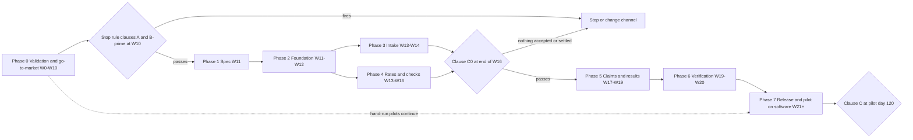

# Execution plan — FreightCheck carrier invoice audit

Phase → milestone → task → subtask. Weeks are counted from the first outreach week (W1). Estimates are hour ranges `[A]`. All scripts and commands are **proposed**; none exists. Requirements: [PRD.md](PRD.md#8-must-haves). Funnel numbers: [Decision.md](Decision.md#12-go-to-market-plan).

## 1. Sequence and gates

No build task starts before the W10 gate, and the W10 gate needs at least one signed and paid (or signed gainshare) pilot. The build therefore starts before any settled credit is known; clause C0 at W16 is the first settled-credit reading and gates Phase 5 and the return of outreach ([Decision.md](Decision.md#9-stop-rule)). Phase 0 needs no application: paid pilots are delivered by the founder with a spreadsheet workbook and a shared folder.

## 2. External dependencies

| Dependency | Blocks | Owner |
|---|---|---|
| Lawyer's answer on outreach law and directory terms | T-0.2.1 | Founder |
| Signed NDA and data authorization per shipper | T-0.2.3, T-0.3.x | Buyer's controller |
| Sample data: 90 days of invoices, rate documents, AP export | T-0.3.1 | Buyer's logistics manager |
| Pilot order form signed and first payment | T-0.4.3; Phase 1 entry | Buyer's controller |
| Buyer sends disputes and forwards carrier replies | T-0.4.4, T-0.5.3, T-7.2.3 | Buyer's approver |
| Extraction provider with no-training terms | T-3.2.1 | Founder |
| US-region VPS and bucket | T-7.1.1 | Founder |
| Founder decisions listed in [Decision.md](Decision.md#11-open-decisions-for-the-founder) | T-0.1.5, T-0.4.1 | Founder |

## 3. Phases, milestones and tasks

### Phase 0 — Validation and go-to-market (no application)

#### M0.1 — Ready to send (W0)

Entry: founder accepts or amends the open decisions. Dependencies: lawyer. Owner: Founder. Outcome: 100 verified prospects and an approved, lawful message. Exit: T-0.1.1 answered in writing; first 100 records pass the list checks; T-0.1.6 passed.

| ID | Need | Owner | Hours | Deliverable | Acceptance check | Subtasks |
|---|---|---|---|---|---|---|
| T-0.1.1 | Outreach law gate | Founder, lawyer | 2-4 | Written answer on the CASL exclusion, CAN-SPAM content including the subject line, directory terms; and, before the first readout, on what act "contests" a bill under 49 U.S.C. 13710(a)(3), from which date the 180 days run, how a contract waiver or a broker contract changes it | No send until the outreach questions are answered; no contest-by date shown to a buyer until the deadline questions are answered or the report says they are open | Brief the lawyer with Decision 4 and 12.4; record answer; update checklist and report wording |
| T-0.1.2 | Prospect list | Founder | 25-30 | 500 distinct prospects, 100 a week | One firm per domain; US address in IL, IN, OH, WI; verified address; not suppressed | Pull from sources; deduplicate; verify; log source per record |
| T-0.1.3 | Sending setup | Founder | 4-6 | Sending domain, mailbox, suppression list, unsubscribe page | Test message shows postal address and working opt-out; opt-out lands in suppression list | Domain records; warm-up; opt-out test |
| T-0.1.4 | Audit workbook and paperwork | Founder | 4-6 | Workbook with the checks C-01 to C-08, NDA, data authorization | Workbook reproduces the UT-01 and UT-03 examples by formula | Build sheets; lawyer template for NDA |
| T-0.1.5 | Message approval | Founder | 1-2 | Final first touch and follow-up | Both contain sender identity, address, opt-out, offer and the three inputs; subject line matches the lookback scope | Edit; checklist |
| T-0.1.6 | Phase 0 data room for confidential rate data | Founder | 3-5 | One storage account in a US region with a folder per shipper; founder-only access with a second factor; encrypted laptop disk; expiring upload links; a data-handling sheet (what is held, where, since when, delete-by date); the same facts written into the NDA and authorization | Region shown in the provider console and recorded; a second account cannot open a folder; a test file uploaded through a link lands in the right folder; no customer file is accepted by email or before this task passes; the workbook lives only inside the data room | Choose provider and record its terms on training and retention; create folders; test access; write the sheet |

#### M0.2 — Outreach and discovery (W1-W7)

Entry: M0.1 exit including T-0.1.6. Dependencies: none. Owner: Founder. Outcome: 500 touched, about 20 replies, 9 calls. Exit: all five batches sent with follow-ups; every reply answered.

| ID | Need | Owner | Hours | Deliverable | Acceptance check | Subtasks |
|---|---|---|---|---|---|---|
| T-0.2.1 | Weekly sends | Founder | 12-15 | 100 first touches a week for W1-W5, follow-up at +4 business days | Sent count per week logged; opt-outs honoured within 10 business days | Schedule; send; process replies and opt-outs |
| T-0.2.2 | Discovery calls | Founder | 7-9 | Notes per call on the seven discovery questions listed in Decision 12.4 and the qualifiers | Each call ends with qualified or disqualified and the reason; answers to questions 6 (free TMS) and 7 (base tariff) recorded for every call | Book; call; log |
| T-0.2.3 | Data intake | Founder | 3-5 | Signed NDA and authorization; files in a per-shipper folder | Nothing opened before signature; file inventory sent back to the buyer | Send paperwork; upload link; inventory |

#### M0.3 — Hand-run lookback audits (W4-W9)

Entry: one data set received. Dependencies: sample data. Owner: Founder. Outcome: about 5.4 audits delivered, 24 hours each. Exit: each delivered audit has a report, a readout and a metrics row.

| ID | Need | Owner | Hours | Deliverable | Acceptance check | Subtasks |
|---|---|---|---|---|---|---|
| T-0.3.1 | Rate setup by hand | Founder | 22-27 | Rate rules per carrier in the workbook with effective dates | Each rule cites document and page; buyer confirms the list of documents is complete | Read documents; key rules; note gaps |
| T-0.3.2 | Line audit and duplicate check | Founder | 90-110 | Checked audit month, accessorial lines of the other two months, 90-day duplicates | Every invoice has a result per check; missing basis recorded as exception, not pass | Key invoices; run checks; second pass on variances |
| T-0.3.3 | Report and readout | Founder | 16-20 | Findings report: variances by reason, exceptions, contest-by dates with their receipt basis; dispute drafts for the ten largest findings above USD 25 | Buyer can trace three sampled findings to documents during the call; no contest-by date is counted from the day files were handed over | Write; ten drafts from templates; call; send pilot order form |
| T-0.3.4 | Audit metrics | Founder | 2-3 | Row per audit: invoices, identified amount in audit month, percent of spend, share of LTL invoices whose base rate could be recomputed, layouts seen, hours | Row complete before the next audit starts | Fill; review |
| T-0.3.5 | Delete non-signers' data | Founder | 1-2 | Deletion of every file and workbook of a shipper that has not signed, 30 days after its readout; a deletion log row (shipper code, date, what, confirmation sent) | Folder no longer exists; provider trash emptied; buyer told in writing; checked weekly against the data-handling sheet | Weekly check; delete; log; notify |

#### M0.4 — Paid pilots sold and delivered by hand (W6-W20)

Entry: one readout held. Dependencies: buyer signature and payment. Owner: Founder. Outcome: about 1.8 paid pilots running on the workbook. Exit: each pilot has a signed order form, a paid invoice or signed gainshare term, a live ledger and a day-60 report.

| ID | Need | Owner | Hours | Deliverable | Acceptance check | Subtasks |
|---|---|---|---|---|---|---|
| T-0.4.1 | Pilot agreement | Founder, lawyer | 3-5 | Order form with scope, price option, refund criterion, lookback claim terms, gainshare duties (monthly AP export of carrier credits during the term and the 120-day tail, fallback fee on accepted amounts), data terms | Matches Decision 5.1 and 5.2 line by line | Draft; legal review |
| T-0.4.2 | Sign and invoice | Founder, buyer | 2-3 | Signed form; USD invoice at signing and day 30, or gainshare terms | Payment received or first statement date set | Send; collect; record |
| T-0.4.3 | Monthly hand audit and drafts | Founder | 65-80 | Checks on each week's invoices; dispute drafts with attachments | Draft sent to the approver within 5 business days of invoice receipt | Weekly batch; drafts; send to approver |
| T-0.4.4 | Hand ledger and time log | Founder, buyer | 10-14 | Sheet per claim: origin (lookback or pilot), claimed, sent date, decision and reason, accepted, settlement method, amount, document; buyer's minutes by activity; founder's minutes per account on field confirmation and queue review, and in total; monthly match of the buyer's AP credit export to the ledger | No settled amount without a carrier document on file; every AP credit matched or marked unrelated | Weekly update call; file documents; monthly reconciliation |
| T-0.4.5 | Day-60 report and conversion | Founder | 4-6 | Report with claimed, accepted, settled, pending, fee, time, NSV; tier proposal | Signer answers convert, continue gainshare or stop | Build; readout; order form |
| T-0.4.6 | Hand delivery after conversion until release | Founder | 30-45 | Same weekly audit, drafts and ledger for converted accounts until W21 | No week skipped; ledger ready for T-7.2.1 | Weekly batch; ledger; hand-over list |

#### M0.5 — Stop-rule decisions (W10, W16, pilot day 120)

Entry: five audits delivered or W10 reached. Dependencies: M0.3 metrics. Owner: Founder. Outcome: written go, extend or stop at each reading. Exit: decision recorded with the numbers. With fewer than five audits at W10 no build starts: outreach resumes at 100 a week until the fifth audit or W14, then clause A is read or the channel is dropped.

| ID | Need | Owner | Hours | Deliverable | Acceptance check | Subtasks |
|---|---|---|---|---|---|---|
| T-0.5.1 | Compute clauses A and B′ | Founder | 2-3 | Count of audits over USD 500 in the audit month; signed pilots; recoverable percent per audit | Numbers come only from T-0.3.4 rows and signed forms | Tally; compare with Decision 9 |
| T-0.5.2 | Decision record | Founder | 1-2 | Go (needs clause A passed and at least one signed and paid or signed gainshare pilot), extend (to the fifth audit by W14, or to 8 audits for B′), or stop | Dated note; if extend, outreach resumes at 100 a week and every later date moves | Write; file |
| T-0.5.3 | Clause C reading | Founder | 2-3 | Self-serve NSV per pilot at day 120 on pilot-period claims, lookback shown separately, founder hours per pilot, and the refund test | Uses carrier documents only; hand-run adjustment applied | Compute; refund if due; record |
| T-0.5.4 | Clause C0 reading at end of W16 | Founder | 2-3 | Accepted and settled amounts with carrier documents on all claims sent by end of W7; settled ÷ claimed; count of claims never sent | Stop Phase 5 and outreach if nothing accepted or settled; one four-week extension if no claim was sent | Tally from T-0.4.4; decide; record |

### Phase 1 — Specification and design (W11)

#### M1.1 — Specification frozen against real findings

Entry: T-0.5.2 says go, which requires at least one signed and paid or signed gainshare pilot. Dependencies: Phase 0 data. Owner: Developer. Outcome: checks, fixtures and screens fixed for the pilot carriers. Exit: fixture set reviewed; provider chosen.

| ID | Need | Owner | Hours | Deliverable | Acceptance check | Subtasks |
|---|---|---|---|---|---|---|
| T-1.1.1 | MH-04, R-21 | Developer | 6-10 | Final check list and reason codes from Phase 0 findings | Every reason code seen in Phase 0 maps to a check; no check without one | Review reports; update PRD; scope cut list |
| T-1.1.2 | MH-02 | Developer | 12-18 | 60 synthetic invoices over 5 layouts with ground truth | No real name, number or rate; reviewed by founder | Re-create layouts; degrade 15; key truth |
| T-1.1.3 | MH-08, MH-10, R-20 | Developer | 8-12 | Wireframes of S-08, S-10, S-11, S-14 | Founder completes the primary path on paper without help | Sketch; walk through; fix labels |
| T-1.1.4 | Dependencies | Founder | 4-8 | Chosen extraction, email, storage providers with prices and terms | No-training term in writing; monthly cost against the model | Compare; record in TRD |

### Phase 2 — Foundation (W11-W12)

#### M2.1 — Repository and environment

Entry: M1.1 exit. Dependencies: none. Owner: Developer. Outcome: one command starts everything locally. Exit: IT-18 and IT-13 pass in CI.

| ID | Need | Owner | Hours | Deliverable | Acceptance check | Subtasks |
|---|---|---|---|---|---|---|
| T-2.1.1 | R-03, R-04, R-06 | Developer | 6-10 | Monorepo with `apps/*`, `packages/*`, import-boundary lint | A forbidden import fails CI | Layout; lint rules; code owners note |
| T-2.1.2 | R-15, R-17 | Developer | 8-12 | Compose stack with health checks, named volumes, `make dev` | Fresh clone to healthy stack with one command; data survives container recreation | Compose file; health endpoints; seed fixtures |
| T-2.1.3 | R-22 | Developer | 4-8 | CI: lint, tests, migration checks; branch rules | `main` protected; branch names follow `T-x.y.z-short-name` | Pipeline; rules; stale-branch report |
| T-2.1.4 | R-07, R-12 | Developer | 6-10 | Shared config, logging and correlation in `packages/platform` | Worker starts with no web module installed; correlation ID appears in API, job and provider logs | Settings; logger; middleware and job wrapper |

#### M2.2 — Schema, tenancy and identity

Entry: M2.1 exit. Dependencies: none. Owner: Developer. Outcome: tenants isolated before any feature exists. Exit: IT-01, IT-02, IT-08, IT-15 pass.

| ID | Need | Owner | Hours | Deliverable | Acceptance check | Subtasks |
|---|---|---|---|---|---|---|
| T-2.2.1 | R-08, R-09, R-10, R-11 | Developer | 12-18 | Migrations for [schema.md](schema.md), parity check, single-head check, backfill runner | CI fails on drift, on two heads and on a non-concurrent index on a populated table | Models; migrations; checks; runner |
| T-2.2.2 | MH-13, R-05 | Developer | 8-12 | RLS policies and the tenant context module used by API and worker | Query without context returns no rows; IT-01 passes | Policies; context; tests |
| T-2.2.3 | MH-13 | Developer | 16-24 | Invitations, password and TOTP enrolment and sign-in, recovery codes, password reset, Owner factor reset, sessions, anti-forgery header, roles, member and settings endpoints, operator grants | IT-15, IT-22 and IT-02 pass | Auth; lifecycle; sessions; role guard; grants |
| T-2.2.4 | MH-13 | Developer | 4-6 | Audit events in the same transaction as changes | Rolling back a change leaves no audit row | Helper; coverage test |
| T-2.2.5 | R-13, R-16 | Developer | 4-8 | Storage key function and signed URL builder using `PUBLIC_BASE_URL` | UT-13 and IT-11 pass | Key builder; URL builder |

### Phase 3 — Intake and extraction (W13-W14)

#### M3.1 — Intake

Entry: M2.2 exit. Dependencies: email provider. Owner: Developer. Outcome: files arrive once, are scanned and queued. Exit: IT-03, IT-04, IT-05 pass.

| ID | Need | Owner | Hours | Deliverable | Acceptance check | Subtasks |
|---|---|---|---|---|---|---|
| T-3.1.1 | MH-01, R-01 | Developer | 8-12 | Signed webhook, sender list with DMARC-aligned authentication result, quarantine, capture of original carrier message date where present | Duplicate and reordered deliveries create one message; a spoofed sender is quarantined (IT-22) | Endpoint; verify; upsert |
| T-3.1.2 | MH-01 | Developer | 8-12 | Upload with size, type and scan checks; S-06 | Bad type refused with reason; infected file never linked | API; scan; screen |
| T-3.1.3 | R-01, R-02 | Developer | 10-14 | Job table, worker loop, transition table, idempotency keys | Late completion after caller timeout is returned on retry | Queue; worker; reconciliation |
| T-3.1.4 | R-19 | Developer | 6-10 | Batch summary and retry of failures only; AP payment import | 20-file batch with 2 failures retries 2 | Batch model; UI; import |

#### M3.2 — Extraction and review

Entry: M3.1 exit. Dependencies: provider chosen. Owner: Developer. Outcome: fields confirmed against the page. Exit: UT-12, E2E-08 pass.

| ID | Need | Owner | Hours | Deliverable | Acceptance check | Subtasks |
|---|---|---|---|---|---|---|
| T-3.2.1 | MH-02 | Developer | 12-20 | Extractor interface, provider client, fake, fixture runner | Accuracy gate on 60 fixtures; version stored | Interface; client; runner |
| T-3.2.2 | MH-02, R-18 | Developer | 20-30 | S-07 and S-08 with viewer, confirm, correction history, manual keying | Unconfirmed money field blocks claim creation, not checks | Viewer; forms; history; drafts |
| T-3.2.3 | R-14 | Developer | 4-6 | Retention sweep for expired uploads | IT-10 passes | Job; metrics |

### Phase 4 — Rates and audit engine (W13-W16, parallel with Phase 3)

#### M4.1 — Rate library

Entry: M2.2 exit. Dependencies: Phase 0 rate documents as models for fixtures. Owner: Developer. Outcome: governing rule resolvable for any date. Exit: UT-02 passes.

| ID | Need | Owner | Hours | Deliverable | Acceptance check | Subtasks |
|---|---|---|---|---|---|---|
| T-4.1.1 | MH-03 | Developer | 16-24 | S-03, S-04; date basis per document, revisions, per-document confirmation, overlap constraint, marking of dependent claims | Unconfirmed document unused; overlap refused naming the revision; a document cannot be confirmed without a date basis | API; grid; confirm; revise; supersede |
| T-4.1.2 | MH-06 | Developer | 8-12 | S-05; fuel schedule bands, week rule, weekly index values with confirmation and revisions | Missing and unconfirmed weeks listed; correction marks dependent claims | API; screen |
| T-4.1.3 | MH-04 | Developer | 8-12 | Governing-rate resolver in `packages/core` | UT-02 passes | Resolver; scope keys |

#### M4.2 — Checks

Entry: T-4.1.3. Dependencies: none. Owner: Developer. Outcome: each check independent and reproducible. Exit: UT-01 to UT-11 pass.

| ID | Need | Owner | Hours | Deliverable | Acceptance check | Subtasks |
|---|---|---|---|---|---|---|
| T-4.2.1 | MH-04 | Developer | 8-12 | Check framework: registry, statuses, exception codes, invoice roll-up | UT-06 passes | Registry; runner; roll-up |
| T-4.2.2 | MH-04 | Developer | 10-16 | C-02 linehaul, discount and minimum; C-07 arithmetic | UT-01, UT-08 pass | Rules; rounding |
| T-4.2.3 | MH-06 | Developer | 8-12 | C-03 fuel by date | UT-03 passes | Basis; band lookup |
| T-4.2.4 | MH-04 | Developer | 8-12 | C-04 accessorial amount and support | UT-04 passes | Schedule match; document test |
| T-4.2.5 | MH-05 | Developer | 6-10 | C-01 duplicates across invoices and AP payments | UT-05 passes | Keys; side-by-side data |
| T-4.2.6 | MH-04 | Developer | 8-12 | C-05 reweigh, C-06 reclass, C-08 late rebill | UT-11 passes | Compare with BOL; certificate test; rebill date |
| T-4.2.7 | MH-09 | Developer | 6-10 | Deadline calculator with receipt evidence rules; daily sweep with reminders and the past-contest-by mark (review round 2, 2026-11-11) | UT-07 and UT-15 pass | Evidence order; bases; broker case; sweep |

### Phase 5 — Claims and results (W17-W19)

#### M5.1 — Exceptions and claims

Entry: M3.2 and M4.2 exit and T-0.5.4 passed. Dependencies: carrier decisions on Phase 0 claims. Owner: Developer. Outcome: a claim can be traced from line to settlement. Exit: IT-06, IT-07, IT-16, IT-19, IT-20, E2E-01, E2E-02 pass.

| ID | Need | Owner | Hours | Deliverable | Acceptance check | Subtasks |
|---|---|---|---|---|---|---|
| T-5.1.1 | MH-07 | Developer | 10-14 | S-09 with tabs, decisions, thresholds | Dismiss needs reason; exceptions never cleared | Queue API; screen; shortcuts |
| T-5.1.2 | MH-08 | Developer | 12-18 | Templates per reason code; evidence packet (.eml, PDF) | UT-14 passes; amounts equal ledger | Templates; packet job |
| T-5.1.3 | MH-08 | Developer | 8-12 | Approve with recompute, stale-basis guard and contest-by guard with override; send record; authenticated BCC capture; basis-changed-after-send flag and withdrawal note | IT-06, IT-19, IT-20 pass | Approve; sent; BCC match; flag |
| T-5.1.4 | MH-10 | Developer | 10-14 | S-12; events with reason codes, settlements, reversal; derived status; claim origin | UT-09, IT-07 pass | Events; settlements; derivation |
| T-5.1.5 | MH-10, R-18 | Developer | 8-12 | S-11 ledger with totals and CSV | Totals equal S-14 for the same filter | List; totals; export |

#### M5.2 — Measurement and administration

Entry: T-5.1.4. Dependencies: none. Owner: Developer. Outcome: NSV computable from stored rows. Exit: UT-10, IT-10 pass.

| ID | Need | Owner | Hours | Deliverable | Acceptance check | Subtasks |
|---|---|---|---|---|---|---|
| T-5.2.1 | MH-11 | Developer | 4-8 | S-13 timer and entries | Edit keeps history | API; screen |
| T-5.2.2 | MH-12 | Developer | 10-14 | S-14 report with drill-down and split by claim origin | UT-10 passes | Query; screen; PDF |
| T-5.2.3 | MH-15 | Developer | 10-14 | Gainshare fee statement with reversal lines; S-18 reconciliation of imported carrier credits | IT-07, IT-21 pass | Statement job; import of credits; matching; view |
| T-5.2.4 | MH-13, MH-14, R-20 | Developer | 12-18 | S-15, S-16, S-02; export and deletion jobs | IT-10 passes; E2E-07 finds no dead link | Settings; audit view; jobs |
| T-5.2.5 | MH-03 | Developer | 6-10 | S-17 operator console under grants | No grant, no access (IT-02) | Console; grant checks |

### Phase 6 — Verification (W19-W20)

#### M6.1 — Test hardening

Entry: M5.2 exit. Dependencies: staging host. Owner: Developer. Outcome: section 7 catalogue green on staging. Exit: all tests pass or are listed as open in the verification file.

| ID | Need | Owner | Hours | Deliverable | Acceptance check | Subtasks |
|---|---|---|---|---|---|---|
| T-6.1.1 | All MH | Developer | 12-18 | Unit and integration suites complete | Every MH has a passing test in the matrix | Fill gaps; property tests |
| T-6.1.2 | R-18, R-20 | Developer | 12-18 | End-to-end and accessibility runs | E2E-01 to E2E-08 pass; manual checks from design 7 recorded | Playwright; keyboard pass; screen reader pass |
| T-6.1.3 | MH-13 | Developer | 8-12 | Security checks against the ASVS list in TRD 8.4 | Each listed requirement has a result; gaps restated; IT-22 passes | Tests; notes |
| T-6.1.4 | R-09, R-15 | Developer | 6-10 | Migration interruption and restore drills | IT-09, IT-12 pass | Drill; timing |
| T-6.1.5 | Quality targets | Developer | 4-6 | Load run | IT-14 meets TRD 10 targets or the gap is recorded | Script; run |

### Phase 7 — Release and pilot on software (W21+)

#### M7.1 — Release and operations

Entry: M6.1 exit. Dependencies: VPS, bucket, domain. Owner: Developer. Outcome: production running with backups and alerts. Exit: restore proven on production-shaped data.

| ID | Need | Owner | Hours | Deliverable | Acceptance check | Subtasks |
|---|---|---|---|---|---|---|
| T-7.1.1 | R-16 | Developer | 6-10 | Production deploy behind Caddy with `PUBLIC_BASE_URL` | Signed links open from outside; no internal host in any link | Provision; deploy; smoke test |
| T-7.1.2 | R-15 | Developer | 4-8 | Backups, WAL archive, restore run | Restore inside the target time | Configure; restore; record |
| T-7.1.3 | Operations | Developer | 4-8 | Alerts from TRD 11 to the founder | Each alert fired once in a test | Rules; test |
| T-7.1.4 | Operations | Developer | 2-4 | Rollback runbook | Previous tag redeployed on staging in under 15 minutes | Write; rehearse |
| T-7.1.5 | R-22 | Developer | 1-2 | Release tag; merged branches deleted | No branch older than 14 days without an owner note | Tag; clean |

#### M7.2 — Pilots on the software

Entry: M7.1 exit. Dependencies: buyers' consent to move data. Owner: Founder. Outcome: decisive question answered per pilot. Exit: T-0.5.3 recorded for every pilot.

| ID | Need | Owner | Hours | Deliverable | Acceptance check | Subtasks |
|---|---|---|---|---|---|---|
| T-7.2.1 | MH-10 | Founder | 6-10 | Hand ledgers and rate rules moved into the app | Ledger totals equal the workbook to the cent | Import; reconcile; Approver confirms rules |
| T-7.2.2 | All MH | Founder | 8-12 | Live intake for pilot accounts | Buyer completes the primary path unaided | Onboard; watch first week |
| T-7.2.3 | MH-12 | Founder | 4-6 | Day-60 and day-120 reports from S-14 | Figures drill to rows | Review with signer |
| T-7.2.4 | PRD 14 | Founder | 2-3 | Expansion or stop note | Uses measured NSV, minutes per claim, settled ÷ claimed | Write; decide |

## 4. Parallel work and critical path

- Critical path: T-0.1.1 → T-0.2.1 → T-0.3.2 → T-0.5.2 → T-2.2.1 → T-4.1.3 → T-4.2.1 → T-5.1.3 → T-5.1.4 → T-6.1.2 → T-7.1.1 → T-7.2.3.
- Parallel: Phase 3 with Phase 4 after M2.2; T-5.2.1 and T-5.2.5 with M5.1; T-0.4.x with every build phase.
- Blocked on a buyer: T-0.2.3, T-0.4.2, T-0.4.4, T-7.2.1. Blocked on payment: Phase 1 entry needs one paid or signed pilot, as T-0.5.2 states. Blocked on carrier decisions: Phase 5 entry needs clause C0 (T-0.5.4).

## 5. Estimate summary

| Phase | Hours, low | Hours, high |
|---|---|---|
| 0 Validation and go-to-market | 313 | 408 |
| 1 Specification | 30 | 48 |
| 2 Foundation | 68 | 108 |
| 3 Intake and extraction | 68 | 104 |
| 4 Rates and checks | 86 | 132 |
| 5 Claims and results | 90 | 134 |
| 6 Verification | 42 | 64 |
| 7 Release and pilot on software | 37 | 63 |
| Build total, phases 1-7 | 421 | 653 |
| Of which before clause C0, phases 1-4 | 252 | 392 |

Phase 0 through day 84 is 232.6 hours in [Decision.md](Decision.md#128-first-30-60-and-90-days); the rest is hand pilot delivery to week 20 (T-0.4.3 covers 1.8 accounts × 60 days at 5.25 hours an account-week, about 81 hours with T-0.4.4) and the clause C reading. The research estimate of 150 hours and 19 days `[C]` is not reconciled with this plan; see [Decision.md](Decision.md#71-cost-categories). Ten build weeks (W11-W20) at the midpoint of phases 1-6 need about 1.4 full-time builders; a solo builder releases about four weeks later and each ramp month from M5 moves one month.

## 6. Proposed scripts and commands

| Proposed command | Purpose | Inputs | Outputs | Failure behaviour |
|---|---|---|---|---|
| `make dev` | Start database, storage, scanner, api, worker, web with health checks | `.env.local` | Healthy stack, seeded synthetic tenant | Exits non-zero naming the unhealthy service |
| `make test` | Unit, integration, end-to-end | Suite name | Report | Non-zero on any failure |
| `make check-boundaries` | Import-boundary lint | Source tree | List of violations | Non-zero if any |
| `make migrate` | Apply migrations with lock timeout | Environment | New schema version | Stops at the failing revision; transactional ones roll back |
| `make db-repair` | Rebuild invalid concurrent indexes | Environment | Valid indexes | Reports and leaves the invalid index in place |
| `make backfill NAME=…` | Resumable backfill | Name, batch size | Progress row | Resumes from the last committed key |
| `make deploy ENV=…` | Build tag, migrate, replace services | Tag | Running release | Aborts before replacing services if migration fails |
| `make restore` | Rebuild database from dump and WAL; file consistency check; deletion replay | Target time | Restored host, report | Stops before serving traffic on any mismatch |
| `make fixtures` | Generate the 60 synthetic invoices | Seed | PDFs and truth files | Non-zero if a truth file is missing |

## 7. Test catalogue

All **Not run**. Synthetic carrier "Example Freight Lines"; synthetic tenants T1 and T2.

### 7.1 Unit tests (`packages/core`, no database)

| ID | Fixture | Action | Expected |
|---|---|---|---|
| UT-01 | 1,200 lb, class 70, USD 38.50 per cwt, discount 62%, minimum 145.00; billed linehaul 203.28 | Run C-02 1,000 times | Expected 12 × 38.50 × 0.38 = 175.56; variance 27.72; identical every run |
| UT-02 | Rate sheet v2 effective 1 Jan-30 Jun, v3 from 1 Jul; pickup 30 Jun and 1 Jul; one unconfirmed v4 | Resolve | v2 then v3; v4 never chosen; date before 1 Jan gives `GOVERNING_RATE_MISSING`; an invoice with no pickup date under a pickup-date basis gives `GOVERNING_DATE_MISSING`; a discount-off-base-tariff rule with no base rates gives `BASE_TARIFF_UNAVAILABLE` while discount and minimum are still checked |
| UT-03 | Fuel schedule: index 3.700-3.749 → 28.0%, 3.750-3.799 → 28.5%; basis pickup date; week rule "a value published on Monday applies to pickups from the next day through the following Monday"; confirmed values 3.74 published Mon 2 Mar 2026 and 3.78 published Mon 9 Mar 2026; billed fuel 63.02 on expected linehaul 175.56 | Run C-03 for pickups on Sat 14 Mar and on Mon 9 Mar | 14 Mar uses 3.78: expected 50.03, variance 12.99. 9 Mar uses 3.74: expected 175.56 × 0.28 = 49.16, variance 13.86. With the 9 Mar value absent: `INDEX_PRICE_MISSING`; entered but unconfirmed: `INDEX_PRICE_UNCONFIRMED`; with no week rule: `FSC_BASIS_MISSING`; in each case the linehaul check still returns its variance |
| UT-04 | Liftgate schedule 85.00; billed 125.00; BOL without liftgate request | Run C-04 | Amount variance 40.00; support flag "not requested on BOL" for human review; no BOL linked gives `DOCUMENT_MISSING` |
| UT-05 | Invoice 884213 twice; same PRO under invoice 884377; AP payment with same PRO and total | Run C-01 | Three duplicate candidates, each naming its match |
| UT-06 | Invoice with no confirmed fuel schedule and a linehaul overcharge | Run all checks | C-03 exception, C-02 variance, C-01 pass; invoice status `needs_input`, never `clean` |
| UT-07 | (a) AP received stamp 2 Mar 2026; (b) no receipt evidence, invoice date 27 Feb 2026; (c) contract 90 days with source, receipt 2 Mar; (d) broker with no term; (e) forwarded late: invoice dated 27 Feb 2026, forward reaches FreightCheck on 28 May 2026, no carrier headers, no AP stamp; (f) as (e) with an attached original carrier message dated 3 Mar 2026 and an AP stamp of 5 Mar | Calculate | (a) 29 Aug 2026 `receipt_plus_180`; (b) 26 Aug 2026 `invoice_date_proxy_plus_180`; (c) 31 May 2026 `contract_term`; (d) null `none_broker`; (e) 26 Aug 2026 by proxy, never 24 Nov 2026 (forward date + 180); (f) 30 Aug 2026 from the earlier evidence, 3 Mar |
| UT-08 | Amounts ending in half cents; tolerance 2.00 | Round and compare | Half-up per line; variance of 1.99 is pass, 2.01 is variance |
| UT-09 | Events entered as sent, decision_partial, acknowledged (late), duplicate decision_partial | Derive status | `partly_accepted`; late acknowledgment does not regress; duplicate ignored by `client_event_id` |
| UT-10 | Settled 2,250.00; fee 299.00; 590 minutes at 40.00; accepted-unsettled 300.00 | Compute NSV | Time 393.33; NSV 1,557.67; the 300.00 excluded. Gainshare on settlements 31.75 and 120.00: fee 30.35; reversal of 31.75 gives a line of −6.35 |
| UT-11 | Original bill received 1 Feb; balance-due bill dated 15 Sep; line items summing 1.00 under the total | Run C-08, C-07 | "Possible late rebill, review" (226 days); arithmetic variance 1.00 below tolerance is pass and is shown |
| UT-12 | 60 fixture invoices | Run extractor | Field accuracy above 95%; no wrong money field above the confidence floor |
| UT-13 | Tenant, purpose, source, file | Build storage key | `t/{tenant}/{purpose}/{source}/{uuid}`; user filename absent; two calls differ |
| UT-14 | Claim with lines 27.72 and 12.99 | Render template | Total 40.71; cites document, page and dates; no free text from a model |
| UT-15 | Confirmed unsent claims with 30, 14, 3 and −1 days left; sweep run twice on the same day | Run the deadline sweep logic | One reminder per threshold per claim, none repeated; the −1 claim is marked `past_contest_by` once and is not expired (review round 2, 2026-11-11); a sent claim is untouched |

### 7.2 Integration tests (real Postgres, fake providers)

| ID | Fixture | Action | Expected |
|---|---|---|---|
| IT-01 | T1 and T2 with invoices, files, claims | T1 user and a T1 job request T2 IDs through API, worker and signed URL | 404 or no rows everywhere; attempt logged |
| IT-02 | One user per role; operator with and without grant | Call every write endpoint | Matches schema 4; Auditor cannot approve; operator cannot settle |
| IT-03 | Same webhook delivered twice and out of order | Post | One message, one file, one job |
| IT-04 | Upload where the response is dropped | Retry with the same key | One file; original result returned |
| IT-05 | Batch of 20 with 2 corrupt | Process, then retry | 18 done, 2 failed with reasons; retry touches 2 |
| IT-06 | Draft claim; fuel schedule confirmed afterwards with an earlier effective date | Approve | 409 `STALE_BASIS` with both amounts; nothing approved |
| IT-07 | Sent claim | Post settlement without document; with document; reverse it | Refused; settled total rises; total falls and next fee statement has a negative line |
| IT-08 | Models and migrations | Parity check | No drift in columns, indexes, checks, exclusion constraints |
| IT-09 | Backfill of 10,000 rows killed halfway | Restart | Completes; no row processed twice |
| IT-10 | Expired temporary uploads; tenant deletion request | Run sweep and deletion; kill and resume | Objects and rows gone; fee statements kept; resume finishes |
| IT-11 | Stack behind the proxy | Request a file link | Host equals `PUBLIC_BASE_URL`; never an internal name |
| IT-12 | Production-shaped synthetic data | Destroy host; `make restore` | Loss at most 15 minutes; under 4 hours; deletion replay applied |
| IT-13 | Worker image without web packages | Start; run one job | Starts; log lines carry the request's correlation ID and no amounts |
| IT-14 | 3 tenants, 20 concurrent uploads each, 500 invoices in an hour | Load run | TRD 10 targets |
| IT-15 | User with TOTP | Reuse a code; sign out and reuse cookie; 5 bad codes | Refused; refused; locked 15 minutes |
| IT-16 | Two Approvers on one claim | Approve at once; double-click approve | One approval; second gets current state |
| IT-17 | Two branches each adding a migration; a plain index on a populated table | CI | Fails on two heads; fails on the non-concurrent index |
| IT-18 | Clean machine | `make dev`; recreate containers | All healthy; database rows still present |
| IT-19 | Confirmed claim whose contest-by date was yesterday | Approve; approve with `override_reason` | 409 `PAST_CONTEST_BY`; then approved with the reason stored, an audit event, and the claim counted in "approvals by date override" |
| IT-20 | Claim sent on fuel index 3.78; Approver then corrects that week's value to 3.74 | Confirm the correction; open the claim; record withdrawal with reason `wrong_rate_basis` | `basis_changed_after_send` true with old and new amounts; withdrawal note generated; claim appears in the wrong-basis metric; a draft on the same value gets `stale_basis` instead |
| IT-21 | Gainshare tenant; AP import with two carrier credits, one already recorded as a settlement | Issue fee statement; match the second credit to its claim with a document; issue again | Refused while one credit is unmatched; after matching, statement includes both, each once |
| IT-22 | Invitation link; user with TOTP and recovery codes; spoofed inbound email from a listed domain failing DMARC; unauthenticated BCC copy; POST without the anti-forgery header | Accept invitation and enrol; reset password; use a recovery code twice; Owner resets a factor; deliver the emails; send the POST | Enrolment required before any data is shown; reset still asks for the code; second use refused; factor reset audited; email quarantined; claim not marked sent; POST refused |

### 7.3 End-to-end tests (browser, staging)

| ID | Fixture | Action | Expected |
|---|---|---|---|
| E2E-01 | Pilot tenant; confirmed rate sheet and fuel schedule; the UT-01 and UT-03 invoice | Forward, confirm fields, confirm variance, approve, mark sent, record partial acceptance of 27.72, record credit memo of 27.72, open report | Claimed 40.71, accepted 27.72, settled 27.72; report drills to the settlement |
| E2E-02 | As E2E-01 with one approved, unsent claim and one sent claim on the same fuel schedule | Approver confirms a corrected fuel schedule revision, tries to mark the first as sent, opens the second | First: stale-basis banner, amounts shown, send blocked until re-approved. Second: "basis changed after send" banner with the withdrawal note |
| E2E-03 | Any | Refresh, Back, Forward and deep link on S-08, S-10, S-11 with filters | State kept; no re-submit; sign-in returns to the link |
| E2E-04 | Queue of 5 variances | Complete confirm, approve, mark sent with keyboard only | Possible; focus visible and never hidden |
| E2E-05 | Batch upload; failed form | Automated accessibility scan; observe live regions | No critical violation; processing and errors announced |
| E2E-06 | Auditor | Open approve URL; sign out; press Back | Role page; signed-out page stays signed out |
| E2E-07 | Whole app | Crawl navigation | No dead route; labels match App-flow |
| E2E-08 | Invoice with an unconfirmed total | Try to create a claim | Blocked with the field named; checks still listed |

## 8. Monitoring, rollback and restore

Monitoring: T-7.1.3. Rollback: T-7.1.4, previous image tag on an expand-then-contract schema. Restore: T-7.1.2 and IT-12. A failed release during a pilot falls back to the workbook of T-0.4.3 for at most one week.
