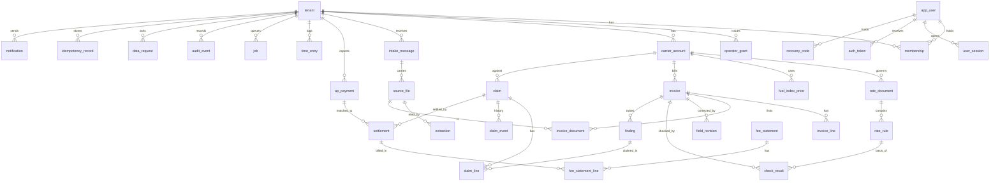

# Schema — FreightCheck carrier invoice audit

Postgres 16, proposed `[P]`. Nothing here exists yet. Stack: [TRD.md](TRD.md#5-building-block-view).

## 1. Entity-relationship diagram

## 2. Conventions

Every table has `id uuid` primary key (default `gen_random_uuid()`) and, except `tenant`, `app_user` and the three per-user tables (`user_session`, `auth_token`, `recovery_code`), `tenant_id uuid not null` referencing `tenant`; every table has `created_at timestamptz not null default now()`. Mutable tables add `updated_at` and `version int not null default 1` for optimistic locking. Money is `bigint` cents with a `currency char(3) not null default 'USD' check (currency = 'USD')`. Rates are `numeric(12,4)`, percentages `numeric(7,4)`. Every foreign key is composite with `tenant_id` so a child cannot point into another tenant. Enumerations are `text` with `check` constraints.

## 3. Dictionary

Only fields beyond the conventions are listed. N = nullable.

### Identity and access

| Table | Field | Type | N | Default, constraint, note |
|---|---|---|---|---|
| tenant | name | text | no | |
| | plan | text | no | `pilot_flat`, `pilot_gainshare`, `starter`, `pro`, `business`, `gainshare` |
| | hourly_rate_cents | bigint | yes | Null means not set; report uses the labelled default |
| | tolerance_cents | bigint | no | 200 |
| | min_claim_cents | bigint | no | 2500 |
| | sender_domains | text[] | no | `'{}'` |
| | inbox_token | text | no | Unique, random; forms the forwarding address |
| | deleted_at | timestamptz | yes | |
| app_user | id, email (citext unique), password_hash, totp_secret_enc, totp_last_step (bigint, a step is accepted once), failed_count, locked_until | | | No `tenant_id`; global |
| user_session | user_id, active_tenant_id, token_hash (unique), created_at, last_seen_at, expires_at, revoked_at | | | No `tenant_id` and no RLS; server-side session. `active_tenant_id` (B1 addition, 2026-11-11) is the tenant chosen at sign-in; the API sets `app.tenant_id` from it and then reads the membership under RLS |
| auth_token | user_id, purpose (`invite`, `reset`), token_hash (unique), expires_at, used_at, invited_tenant_id, invited_role | | | Single use; invitation 7 days, reset 30 minutes |
| recovery_code | user_id, code_hash, used_at | | | Ten per user; unique (user_id, code_hash) |
| idempotency_record | key, route, request_hash, response_status, response_body, expires_at | | | Unique (tenant_id, route, key); kept 24 hours |
| notification | kind (`deadline_30`, `deadline_14`, `deadline_3`, `carrier_overdue`), entity_id, sent_at | | | Unique (tenant_id, kind, entity_id) so a reminder is sent once. Built in migration 0002 with forced RLS; the daily sweep job is enqueued per tenant by the `SECURITY DEFINER` function `fc_enqueue_deadline_sweeps(date)` (review round 1, 2026-11-11) |
| membership | user_id | uuid | no | FK `app_user` |
| | role | text | no | `owner`, `approver`, `auditor`, `viewer`; unique (tenant_id, user_id) |
| operator_grant | operator_user_id, granted_by | uuid | no | |
| | expires_at | timestamptz | no | Check: at most 30 days after `created_at` |
| | revoked_at | timestamptz | yes | |

### Rates

| Table | Field | Type | N | Default, constraint, note |
|---|---|---|---|---|
| carrier_account | name, scac | text | no / yes | Unique (tenant_id, lower(name)) |
| | carrier_type | text | no | `motor_carrier`, `broker`, `other` |
| | claims_email | citext | yes | |
| | dispute_window_days | int | yes | Check: null or `dispute_window_source_file_id` not null |
| | dispute_window_source_file_id | uuid | yes | FK `source_file` |
| rate_document | carrier_account_id | uuid | no | |
| | doc_type | text | no | `contract_rate_sheet`, `tariff`, `accessorial_schedule`, `fuel_schedule`, `rate_confirmation` |
| | effective_from | date | no | |
| | effective_to | date | yes | Check: null or after `effective_from` |
| | scope_key | text | no | `'*'`; lane group or, for a rate confirmation, the PRO. A lane-scoped document applies to invoices with that `lane_key`; while an invoice's lane is unknown, a lane-scoped document that may govern blocks the check (review round 1, 2026-11-11) |
| | date_basis | text | no | `pickup_date`, `tender_date`, `delivery_date`, `invoice_date`; selects the governing date for every rule in the document |
| | date_basis_source_page | int | yes | Null means the document is silent and the Approver chose; shown as a flag |
| | revision | int | no | 1; a change to a confirmed document inserts a new row with revision + 1 and `revises_id`; not the optimistic-lock `version` |
| | revises_id | uuid | yes | Previous revision |
| | status | text | no | `entered`, `confirmed`, `superseded`. Confirmation is per document; rules have no status of their own |
| | confirmed_by, confirmed_at | uuid, timestamptz | yes | Required when `confirmed` |
| | source_file_id | uuid | no | The document itself |
| | | | | Exclusion constraint: no two `confirmed` rows overlap in `daterange(effective_from, effective_to)` for the same (tenant_id, carrier_account_id, doc_type, scope_key) |
| rate_rule | rate_document_id | uuid | no | |
| | rule_type | text | no | `linehaul`, `minimum`, `discount`, `base_tariff_ref`, `accessorial`, `fuel_band`, `fuel_week_rule` (which published index value applies to a governing date) |
| | params | jsonb | no | Validated per `rule_type` by the core package |
| | source_page | int | yes | |
| | entered_by | uuid | no | |
| fuel_index_price | carrier_account_id | uuid | yes | Null = shared within the tenant |
| | index_name | text | no | As named in the carrier's schedule |
| | week_start | date | no | Unique (tenant_id, carrier_account_id, index_name, week_start) |
| | price | numeric(7,4) | no | |
| | published_on | date | no | |
| | source_note | text | no | Where the user read it |
| | status, confirmed_by, confirmed_at | | | `entered`, `confirmed`, `superseded`; only `confirmed` values are used. At most one confirmed value per (tenant, carrier or tenant-wide, index, week) (`uq_fuel_index_price_one_confirmed`); a carrier-specific and a tenant-wide value for the same week are used only when equal (review round 1, 2026-11-11) |
| | revision, revises_id | | | A correction is a new row; unique key above includes `revision` |

### Intake

| Table | Field | Type | N | Default, constraint, note |
|---|---|---|---|---|
| intake_message | channel | text | no | `email`, `upload`, `import` |
| | provider_message_id | text | yes | Unique (tenant_id, provider_message_id) |
| | sender, received_at | citext, timestamptz | yes / no | `received_at` is FreightCheck's receipt and is never a receipt-of-bill date |
| | auth_result | text | yes | `dmarc_pass`, `fail`, `none`, from the provider |
| | original_sent_at, original_from | timestamptz, citext | yes | From an attached original message or preserved carrier headers only |
| | state | text | no | `received`, `quarantined`, `processed`, `failed` |
| source_file | intake_message_id | uuid | yes | |
| | sha256 | bytea | no | Unique (tenant_id, sha256, purpose) |
| | purpose | text | no | `invoice`, `bol`, `rate_confirmation`, `delivery_receipt`, `weight_certificate`, `rate_document`, `carrier_response`, `settlement_evidence`, `ap_export` |
| | storage_key | text | no | Unique; built only by the platform key function |
| | byte_size, mime | bigint, text | no | |
| | scan_state | text | no | `pending`, `clean`, `infected` |
| | expires_at | timestamptz | yes | Set for temporary uploads |
| extraction | source_file_id | uuid | no | |
| | extractor_version | text | no | Unique (tenant_id, source_file_id, extractor_version) |
| | fields | jsonb | no | Value, confidence, page, region per field |
| job | kind, state | text | no | States `queued`, `running`, `done`, `failed`, `needs_manual`. The worker claims the next job through the `SECURITY DEFINER` function `fc_claim_next_job(kinds)`, which returns only the job id and tenant id (B1 addition); all further work runs under that tenant's RLS context |
| | idempotency_key | text | no | Unique (tenant_id, kind, idempotency_key) |
| | attempt, run_after, correlation_id, payload, last_error | | | `payload` holds IDs only |

### Invoices and checks

| Table | Field | Type | N | Default, constraint, note |
|---|---|---|---|---|
| invoice | carrier_account_id | uuid | no | |
| | invoice_number, pro_number | text | no / yes | Unique (tenant_id, carrier_account_id, invoice_number, revision_of) so a carrier's corrected invoice is a new row linked by `revision_of` |
| | invoice_date, pickup_date, tender_date, delivery_date | date | yes, all | A missing date that a check or the deadline needs gives an exception |
| | receipt_date | date | yes | The shipper's receipt of the carrier's bill; earliest available evidence |
| | receipt_basis | text | no | `carrier_transmission` (original carrier message date), `ap_received_stamp` (from the AP import), `user_entered` (needs `receipt_note`), `unknown` |
| | receipt_note | text | yes | Required for `user_entered` |
| | contest_by | date | yes | Written only by the deadline calculator |
| | deadline_basis | text | no | `receipt_plus_180`, `invoice_date_proxy_plus_180`, `contract_term`, `none_broker` |
| | total_cents, billed_weight_lb, billed_class | | | |
| | lane_key | text | yes | Lane group that selects lane-scoped documents; null = unknown (migration 0002 (review round 1, 2026-11-11)) |
| | fields_confirmed | boolean | no | false |
| | status | text | no | `needs_review`, `needs_input`, `variance`, `clean`; set by the engine; check: `clean` only when no exception exists (enforced in code, tested by UT-06) |
| | field_revision, ruleset_revision | int | no | Inputs to the checks idempotency key |
| invoice_line | invoice_id, line_no | | no | Unique (invoice_id, line_no) |
| | charge_type | text | no | `linehaul`, `fuel`, `accessorial`, `discount`, `other` |
| | accessorial_code, description | text | yes | |
| | amount_cents | bigint | no | |
| invoice_document | invoice_id, source_file_id, doc_role | | no | Unique (invoice_id, source_file_id) |
| field_revision | invoice_id, field, old_value, new_value, changed_by, reason | | | Append-only |
| check_result | invoice_id, run_no, check_code | | no | Unique (invoice_id, run_no, check_code, line_no), nulls not distinct. `check_code` is `C-01`...`C-08` or a sub-result `C-02-BASE` (base-rate exception) or `C-04-SUPPORT` (support question), per PRD 8.1 |
| | line_no | int | yes | |
| | status | text | no | `pass`, `variance`, `exception`, `not_applicable` |
| | exception_code | text | yes | Required when `exception`: `GOVERNING_RATE_MISSING`, `GOVERNING_DATE_MISSING`, `BASE_TARIFF_UNAVAILABLE`, `FSC_BASIS_MISSING`, `INDEX_PRICE_MISSING`, `INDEX_PRICE_UNCONFIRMED`, `FIELD_UNCONFIRMED`, `DOCUMENT_MISSING`, `ENGINE_ERROR` |
| | expected_cents, billed_cents, variance_cents | bigint | yes | |
| | rate_rule_id, rate_document_revision, fuel_index_price_id | | yes | Basis |
| | governing_date | date | yes | |
| | arithmetic | jsonb | no | Inputs and steps; `basis` lists every document id and revision and fuel index value id the result used (C-03 includes the linehaul document); `review_flags` for questions to a person |
| | engine_version | text | no | |
| finding | invoice_id, check_code, line_no | | | Unique; survives re-runs |
| | current_result_id | uuid | no | |
| | decision | text | no | `open`, `confirmed_for_claim`, `dismissed`, `below_threshold` |
| | dismiss_reason, decided_by, decided_at | | yes | |
| ap_payment | kind (`payment`, `credit`, `refund`), carrier_name, invoice_number, pro_number, paid_date, received_date (nullable), amount_cents, carrier_reference, reconcile_state (`unmatched`, `matched`, `unrelated`), reconcile_reason, reconciled_by | | | Imported. Payments feed the duplicate check and the AP received stamp; credits and refunds feed gainshare reconciliation |

### Claims, settlement, time, fees

| Table | Field | Type | N | Default, constraint, note |
|---|---|---|---|---|
| claim | carrier_account_id, invoice_id | uuid | no | One claim per invoice; unique (tenant_id, invoice_id) where not withdrawn |
| | reference | text | no | Unique (tenant_id, reference) |
| | status | text | no | Derived from events by the core package, stored for queries: `draft`, `approved`, `sent`, `acknowledged`, `accepted`, `partly_accepted`, `denied`, `settled`, `withdrawn`, `expired` |
| | claimed_cents | bigint | yes | Null while draft; frozen at approval |
| | accepted_cents | bigint | yes | Null until a decision event |
| | settled_cents | bigint | no | 0; equals the sum of unreversed settlements, maintained in the same transaction |
| | basis_snapshot | jsonb | yes | Written at drafting and refreshed at approval: claim lines (finding, claimed cents, basis) plus `document_ids` and `fuel_index_price_ids` arrays, which the marking of dependent claims queries |
| | origin | text | no | `lookback`, `pilot`, `recurring`; set from the invoice's intake batch |
| | stale_basis | boolean | no | false; set when a basis changes before sending; blocks approve and mark-sent |
| | basis_changed_after_send | boolean | no | false; set when a basis changes after sending; cleared only by a withdrawal or an Approver's recorded review |
| | basis_changed_after_send_at | timestamptz | yes | B1 addition: first time the flag was set; never cleared; counts the claim in the wrong-basis metric |
| | late_override_reason | text | yes | Set when approved after `contest_by` |
| | late_send_reason, late_send_by | text, uuid | yes | Set together when the send is recorded after `contest_by` (migration 0002 (review round 1, 2026-11-11)) |
| | approved_by, approved_at, sent_at, sent_to | | yes | |
| claim_line | claim_id, finding_id, claimed_cents | | no | Unique (claim_id, finding_id) |
| claim_event | claim_id | uuid | no | Append-only |
| | event_type | text | no | `drafted`, `approved`, `sent`, `acknowledged`, `decision_accepted`, `decision_partial`, `decision_denied`, `short_paid`, `carrier_rebilled`, `withdrawn`, `expired` |
| | occurred_on | date | no | Date on the carrier's or user's document |
| | amount_cents | bigint | yes | |
| | evidence_file_id | uuid | yes | Check: not null for decision events |
| | reason_code | text | yes | Required for `decision_denied`, `decision_partial` and `withdrawn`: `wrong_rate_basis`, `charge_supported_by_carrier`, `time_barred`, `duplicate_claim`, `other` |
| | reason_note | text | yes | |
| | client_event_id | text | no | Unique (claim_id, client_event_id) |
| settlement | claim_id | uuid | no | |
| | method | text | no | `credit_memo`, `refund_payment`, `corrected_invoice`, `short_pay_accepted` |
| | amount_cents | bigint | no | Check > 0 |
| | settled_on | date | no | |
| | evidence_file_id | uuid | no | |
| | carrier_reference | text | yes | Unique (tenant_id, claim_id, method, carrier_reference) |
| | ap_payment_id | uuid | yes | The imported credit or refund this settlement was reconciled to |
| | reversed_at, reversed_by, reverse_reason | | yes | |
| | excess_reason | text | yes | Required when settlements would exceed accepted (or claimed before a decision) (migration 0002 (review round 1, 2026-11-11)) |
| time_entry | user_id, activity, minutes, work_date | | no | `activity` in `setup`, `review`, `dispute`; check minutes between 1 and 720 |
| | supersedes_id | uuid | yes | Edits create a new row |
| fee_statement | period_start, period_end, plan, total_cents, issued_at | | | Unique (tenant_id, period_start, plan) |
| fee_statement_line | fee_statement_id, settlement_id, basis_cents, fee_cents | | | Unique (settlement_id, fee_statement_id); negative for reversals |
| audit_event | actor_user_id, actor_role, operator_grant_id, action, entity_type, entity_id, before_hash, after_hash, correlation_id | | | Append-only; no update or delete privilege |
| data_request | kind (`export`, `delete`), state, requested_by, completed_at, result_file_id | | | |

## 4. Permissions and tenant boundary

| Object | Owner | Approver | Auditor | Viewer | Operator in grant | Worker |
|---|---|---|---|---|---|---|
| Users, plan, grants, export, deletion | write | none | none | none | none | executes |
| Carrier accounts, dispute window | write | write | read | read | read | read |
| Rate documents and rules | write | write, confirm | enter | read | enter | read |
| Fuel index values | write | write, confirm | enter | read | enter | read |
| Tenant settings, members, factor reset | write | read | read | read | none | none |
| Reconciliation of carrier credits | write | write | read | read | read (gainshare tenants) | none |
| Invoices, fields, findings | write | write | write | read | write fields | write |
| Claim draft | write | write | write | read | none | write packet |
| Approve, send-record, events, settlements | write | write | none | read | none | none |
| Time entries | write | own | own | read | none | none |
| Reports, fee statements | read | read | read | read | none | write |
| Audit events | read | none | none | none | none | insert |

Tenant boundary: RLS policy `tenant_id = current_setting('app.tenant_id')::uuid` on every tenant table, forced for the application role; the setting is unset by default, so a query without context returns nothing. Uniqueness is scoped to the tenant in every constraint above; invoice numbers, references and file hashes may repeat across tenants. Cross-tenant denial: a foreign ID yields no row, the API answers 404, and storage keys are derived from the row, never from user input. The migration role is separate from the application role.

## 5. Indexes and their queries

| Index | Query served |
|---|---|
| invoice (tenant_id, status, contest_by) | S-07 and S-09 lists sorted by days left |
| invoice (tenant_id, carrier_account_id, pro_number) | Duplicate check by PRO |
| invoice (tenant_id, pro_number, invoice_date, total_cents) | Duplicate check by PRO, date and total |
| ap_payment (tenant_id, lower(carrier_name), invoice_number) | Duplicate check against paid history |
| rate_document gist (tenant_id, carrier_account_id, doc_type, scope_key, daterange) | Governing-rate resolver; backs the exclusion constraint |
| check_result (tenant_id, invoice_id, run_no desc) | Latest results on S-08 |
| finding (tenant_id, decision, check_code) | Queue tabs on S-09 |
| claim (tenant_id, status, sent_at) | Ledger S-11 and carrier-overdue reminders |
| settlement (tenant_id, settled_on) where reversed_at is null | NSV and fee statement by window |
| ap_payment (tenant_id, kind, reconcile_state) | Unmatched carrier credits before a fee statement |
| invoice (tenant_id, contest_by) | Deadline sweep and reminders, joined to claims in `draft` or `approved` |
| time_entry (tenant_id, work_date) | NSV time cost |
| job (state, run_after) where state = 'queued' | Worker poll |
| source_file (expires_at) where expires_at is not null | Retention sweep |
| audit_event (tenant_id, created_at desc) | S-16 |

## 6. Provenance, versions and timestamps

- Every invoice field traces to `extraction.fields` (extractor version, page, region) or a `field_revision` (user, time, reason).
- Every check result stores engine version, rule ID, document version, governing date and arithmetic. A claim stores a `basis_snapshot` at drafting and again at approval.
- Event dates (`occurred_on`, `settled_on`) are the dates on documents; `created_at` is when FreightCheck learned of them. Reports use document dates and show both when they differ by more than 7 days.

## 7. Transactions and duplicates

| Operation | One transaction contains | Duplicate handling |
|---|---|---|
| Intake | `intake_message` upsert, `source_file` rows, jobs | Provider message ID and file hash unique; the second arrival links to the first |
| Field confirmation | `field_revision`, invoice update, `run_checks` job | `version` check |
| Check run | All `check_result` rows of a run, findings upsert, invoice status | Idempotency key of invoice, field revision and rule-set revision |
| Approval | Recompute, date check, `claim` update, `claim_event`, `audit_event` | `Idempotency-Key` stored in `idempotency_record`; second call returns the first result |
| Confirming a document revision or index value | Status change, supersede the prior revision, set `stale_basis` or `basis_changed_after_send` on every claim whose `basis_snapshot` used the prior revision, `audit_event` | `version` check |
| Settlement | `settlement`, `claim.settled_cents`, status, `audit_event` | Carrier reference unique per claim and method |
| Fee statement | Statement and lines for unbilled settlements and reversals | One statement per period and plan |

## 8. Sensitivity, retention, export, deletion, backups

| Data | Sensitivity | Retention `[P]` |
|---|---|---|
| Rate documents, rules, invoices, BOLs | Confidential commercial | Life of the account plus 90 days |
| Lookback data from a prospect that does not sign | Confidential commercial | 30 days after the readout |
| Temporary uploads never linked | Confidential | 7 days (`expires_at`) |
| Claims, settlements, audit events | Confidential | Life of the account plus 90 days |
| Fee statements | Billing record | 7 years, identifiers and amounts only |
| Credentials, TOTP secrets | Secret | Until user removal |

- Export: a `data_request` builds CSV per table plus the files in a zip under the tenant's export prefix; the link expires in 24 hours.
- Deletion: sets `tenant.deleted_at`, stops intake at once, deletes bucket objects by tenant prefix, then rows table by table in resumable batches; fee statements are kept with identifiers only. Completion is reported to the Owner.
- Backups: dumps and WAL expire after 35 days, so deleted data leaves backups within 35 days; the confirmation states that date.
- Restore: after a restore, a deletion replay job re-applies every completed `data_request` of kind `delete` from a ledger kept outside the database, so restored backups do not resurrect deleted tenants.

## 9. Migrations

- Ordering: Alembic with a single linear head; CI fails if two heads exist (R-10). Files are named by sequence and purpose.
- ORM parity: CI creates a database from migrations and compares it with the models, including indexes, checks and exclusion constraints (R-08).
- Expand then contract: add nullable column or new table, backfill, switch code, then drop in a later release, so the previous image still runs.
- Backfills: separate resumable jobs keyed by primary-key range with a progress row; safe to re-run (R-09).
- Locks: indexes on populated tables use `CREATE INDEX CONCURRENTLY` outside a transaction; `lock_timeout` of 5 seconds on DDL; constraints added `NOT VALID` then validated (R-11).
- Partial execution: each migration is one transaction except concurrent index builds, which are detected as invalid and rebuilt by a proposed `make db-repair` step.
